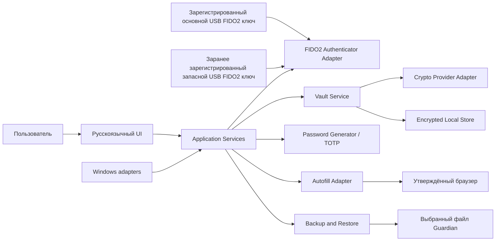

# Guardian 1.0 — ADD после согласования (сценарная версия)

**ADD:** Architecture Design Document (документ архитектурного проектирования).
**Статус:** проект предполагаемого согласованного решения для учебного сценария; Change-01 не является фактическим утверждением или изменением базового SRS.
**Связанные документы:** [план и функциональность](plan.md), [SDD](sdd.md), базовый [SRS RU](../../../srs/guardian-srs.md), ADR проекта в `../../adr/`.

## 1. Назначение и границы

Архитектурная основа Guardian сохраняется: локальное Java Desktop-приложение для Windows без сервера, облачной синхронизации и blockchain/RPC. Все базовые функции из SRS остаются. В этом согласовательном сценарии добавлен Change-01: предварительная регистрация запасного USB-ключа FIDO2/WebAuthn и возможность разблокировки одним из двух зарегистрированных ключей.

Сценарий Change-01 не вводит восстановление доступа после потери обоих ключей. Он также не добавляет wallet/key generation, импорт кошельков, балансы, транзакции, подпись или отправку.

## 2. Архитектурные драйверы

- Все базовые драйверы из SRS сохраняются: REQ-FUNC-001–012 и относящиеся требования безопасности, надёжности и интеграции.
- Change-01 (сценарная связь с REQ-FUNC-010): предварительная регистрация и проверка второго ключа; для разблокировки требуются мастер-пароль и один из двух зарегистрированных ключей.
- Запасной ключ должен использовать ту же доверенную границу FIDO2 Authenticator Adapter; новый сетевой сервис не появляется.
- Регистрация/учёт ключей и все ошибки требуют security-review; технологию хранения регистрации не фиксировать до утверждения дизайна безопасности.

## 3. Контекст и логические компоненты

| Компонент | Ответственность после Change-01 | Ограничение |
|---|---|---|
| UI / Application Services | Сценарий enroll второго ключа, проверка статуса и понятные ошибки. | Не разрешать разблокировку только паролем. |
| FIDO2 Authenticator Adapter | Регистрация/проверка до двух USB FIDO2/WebAuthn ключей и проверка одного из зарегистрированных при входе. | Конкретный протокол/SDK/модель учётных данных требует PoC и security-review. |
| Vault Service | Предоставление доступа к хранилищу только после мастер-пароля и успешного FIDO2 challenge одним из зарегистрированных ключей. | Если оба ключа потеряны, Change-01 не предоставляет обходной доступ. |
| Crypto Provider Adapter / Encrypted Local Store | Защита хранилища и пользовательских секретов. | Алгоритмы/KDF/параметры остаются открытыми до ADR-0002. |
| Backup/Restore | Работа с зашифрованным файлом Guardian. | Не предполагать включение/перенос регистрации MFA в backup без отдельного решения. |
| Остальные базовые компоненты | Обычные записи, TOTP, generator, autofill, Windows integration и диагностика. | Без изменения исходных границ SRS. |

## 4. Критические потоки

### 4.1 Предварительная регистрация запасного ключа

1. Пользователь аутентифицирован согласно утверждённому процессу управления хранилищем.
2. UI запускает явное действие «добавить запасной ключ»; Authenticator Adapter проверяет совместимость ключа и завершает enrollment.
3. Пользователь подтверждает тестовую проверку запасного ключа до завершения настройки.
4. Статус регистрации показывается без раскрытия секретных аутентификационных данных.

Этот поток описывает требуемое поведение, а не формат хранения credential или детали UX; они требуют отдельного проектного решения и security-review.

### 4.2 Разблокировка после регистрации двух ключей

1. Пользователь вводит мастер-пароль.
2. Authenticator Adapter подтверждает владение одним из зарегистрированных ключей (основным или запасным).
3. Vault Service открывает хранилище только после прохождения обоих факторов.
4. Отсутствующий, не зарегистрированный или неверный ключ приводит к отказу и сохранению состояния `Locked`.
5. Если утрачены оба ключа, никакого восстановления только по мастер-паролю в Change-01 нет; этот сценарий должен быть отдельно определён и согласован.

### 4.3 Неизменившиеся потоки

Кошелёк остаётся локальным защищённым хранилищем предоставленных пользователем metadata/seed/private key с явным ручным просмотром/копированием. Backup, автозаполнение и остальные базовые потоки сохраняют исходные проверки безопасности.

## 5. Данные, безопасность и развёртывание

- Нельзя предполагать, что security credential или секреты ключа записываются открыто; алгоритм хранения не описывается до выбора и review.
- Ключевой процесс не добавляет сетевой аккаунт или облачное хранение.
- Ошибки enrollment, подмена ключа, повторное использование, потеря/замена и невалидный challenge должны войти в негативные тесты Change-01.
- Security-review, PoC и проверка основного FIDO2-потока сохраняются; срок не оправдывает их сокращение.
- Компоненты и deploy-модель остаются локальными; Java, Windows и открытые решения наследуются из базового ADD.

## 6. Открытые решения

| Решение | Статус после переговорного сценария |
|---|---|
| Разрешённый FIDO2 enrollment protocol, SDK и поддерживаемые модели ключей | Подтвердить через PoC; не выбрано этим ADD. |
| Защищённое хранение идентификаторов/состояния регистрации | Спроектировать и одобрить security-review до реализации. |
| UX добавления, замены/удаления и проверки spare key | Уточнить с владельцем продукта; сценарий требует явной предварительной проверки. |
| Потеря обоих зарегистрированных ключей | Не покрывается Change-01; отдельное решение, не реализовывать по умолчанию. |
| JDK/UI, crypto parameters, browser matrix, wallet-data model | Остаются открытыми как в базовом SDD/ADR. |

## 7. Трассировка и статус согласования

Сценарная трассировка: Change-01 → UX/enrollment flow → FIDO2 Authenticator Adapter → MFA gate → Vault Service → negative/security tests. Базовые потоки трассируются к DES-CTX-001, DES-CMP-001, DES-INF-001, DES-INT-001, DES-ALG-001 и DES-DEP-001 в [SDD](sdd.md).

Это документированная гипотеза после переговоров, а не запись о реально полученном согласии. До фактического подтверждения владельцем продукта базовый SRS и текущие ADR остаются нормативными; Change-01 нельзя выдавать за утверждённое требование.
