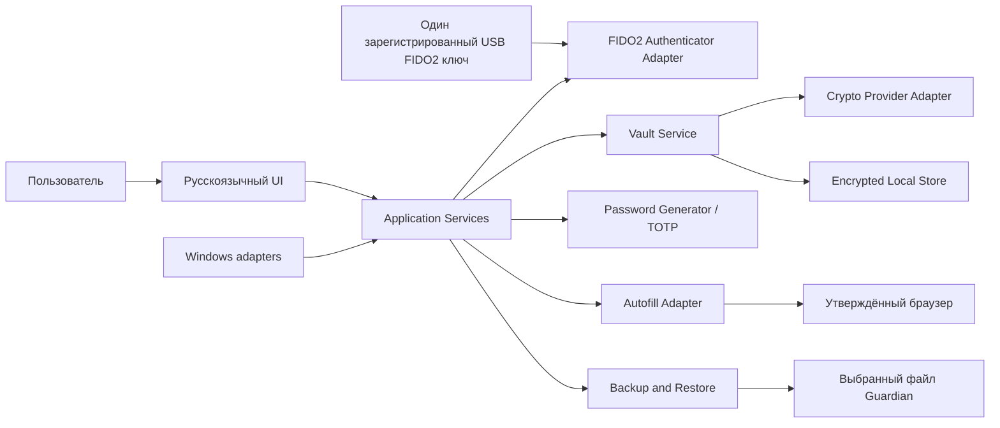

# Guardian 1.0 — ADD до согласования

**ADD:** Architecture Design Document (документ архитектурного проектирования).
**Статус:** предварительная архитектурная версия до согласования; базовый SRS, без Change-01.
**Связанные документы:** [план и функциональность](plan.md), [SDD](sdd.md), базовый [SRS RU](../../../srs/guardian-srs.md), ADR проекта в `../../adr/`.

## 1. Назначение и границы

Guardian 1.0 — локальное настольное приложение на Java для Windows 10 и новее. Архитектура рассчитана на работу без серверной части и сетевого аккаунта. Хранилище содержит пользовательские записи, парольные данные, TOTP и предоставленные пользователем метаданные/секреты кошельков. Изменение требований или выбор алгоритма шифрования не утверждается этим документом.

Вне границ: генерация кошельков/ключей, импорт из внешних wallet-приложений, blockchain/RPC, балансы, транзакции, подпись, отправка, облако и автоматическая синхронизация.

## 2. Архитектурные драйверы

- Защищённое локальное хранение и MFA — REQ-FUNC-001, REQ-FUNC-010, REQ-SEC-001–003.
- Записи и явные действия над секретами — REQ-FUNC-002–005, REQ-FUNC-009, REQ-FUNC-011–012.
- Безопасные backup/restore — REQ-FUNC-008, REQ-REL-001–002.
- Проверяемое автозаполнение — REQ-FUNC-006, REQ-SEC-005, REQ-INT-003.
- Отсутствие сетевой обработки кошельков и утечек — CON-05, CON-11, REQ-SEC-006.

## 3. Контекст и логические компоненты

| Компонент | Ответственность | Ограничение |
|---|---|---|
| UI | Ввод команд, состояние и отображение; секреты скрыты по умолчанию. | Не хранит секреты самостоятельно. |
| Application Services | Сценарии, валидация разрешённых состояний, координация модулей. | Не обходит Vault/MFA. |
| Vault Service | Граница доступа к расшифрованным записям. | Доступ только после мастер-пароля и зарегистрированного второго фактора. |
| FIDO2 Authenticator Adapter | Вызов платформенного механизма USB FIDO2/WebAuthn. | Конкретная SDK/библиотека требует PoC и ADR. |
| Crypto Provider Adapter | Единая граница к проверенной криптобиблиотеке. | Алгоритмы, KDF и параметры не выбраны этим ADD. |
| Encrypted Local Store | Локальная персистентность. | Не записывает секреты в открытом виде. |
| Backup/Restore | Экспорт, проверка целостности и восстановление формата Guardian. | Не импортирует форматы других менеджеров. |
| Autofill Adapter | Передача выбранных полей после точной проверки источника. | Поддерживаемые браузеры требуют матрицы. |
| Windows adapters | Блокировка сеанса, буфер обмена, файловые диалоги. | Не создают отдельный сетевой сервис. |

## 4. Критические потоки

### 4.1 Разблокировка

1. Пользователь вводит мастер-пароль.
2. Authenticator Adapter запрашивает зарегистрированный USB FIDO2/WebAuthn фактор.
3. Vault Service предоставляет доступ только после успешного прохождения обоих факторов.
4. При отказе остаётся состояние `Locked`; проверка одного мастер-пароля не считается успешной аутентификацией.

### 4.2 Секрет кошелька

Запись, включая пользовательские seed-фразы и приватные ключи, доступна только после MFA. Секрет маскируется, раскрывается/копируется отдельной командой, не индексируется, не попадает в журналы или сеть. Внутренний формат записи/модуля остаётся открытым.

### 4.3 Backup/restore и автозаполнение

Backup создаётся в собственном зашифрованном формате; формат и целостность проверяются до замены текущего хранилища. Автозаполнение запускается только после явного выбора пользователя и проверки схемы, хоста и эффективного порта, в том числе после перенаправления.

## 5. Данные, безопасность и развёртывание

- Секретные поля и резервная копия используют только утверждённый криптографический механизм; самописные криптопримитивы запрещены.
- Мастер-пароль и ключ расшифрования не сохраняются в открытом виде; секреты исключаются из логов, поиска и диагностики.
- Блокировка ограничивает доступ UI к plaintext и инициирует очистку буфера обмена, насколько это позволяет Windows.
- Java Desktop для Windows; точный JDK, UI-фреймворк, сборка и упаковка фиксируются после PoC.
- Сервера и внешние сети в контекст релиза не входят.

## 6. Открытые архитектурные решения

| Решение | Статус до согласования |
|---|---|
| Алгоритмы, KDF и параметры криптографии | Требуют PoC и security-review; см. ADR-0002. |
| Внутренняя модель wallet-data: тип записи или модуль | Не выбрана; см. ADR-0003. |
| JDK, UI и платформенная FIDO2-интеграция | Требуют технического выбора и PoC. |
| Матрица браузеров и интерфейс автозаполнения | Требуют решения владельца продукта. |
| Recovery после утраты USB FIDO2-ключа | Открытый вопрос REQ-FUNC-010; восстановление по одному паролю не допускается. |

## 7. Трассировка и согласование

Архитектурные представления соответствуют DES-CTX-001, DES-CMP-001, DES-INF-001, DES-INT-001, DES-ALG-001 и DES-DEP-001 в [SDD](sdd.md). Этот ADD фиксирует структуру и границы, но не заменяет SRS, ADR и security-review. Все пункты со статусом «открыто» должны быть закрыты до соответствующей реализации.
