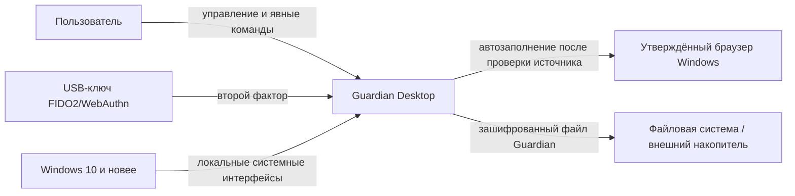
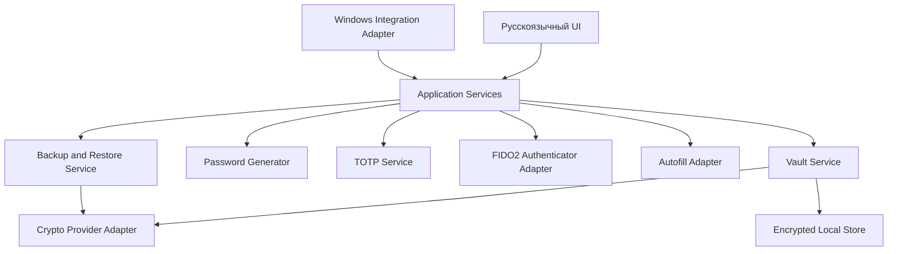

# Описание дизайна программного обеспечения (SDD)

Для **Guardian — менеджера паролей**, релиз 1.0
Версия документа: 0.1 (проект)
Подготовил: Исполнитель (учебная работа)
Организация: БГУИР
Дата: 2026-11-07

## История изменений

| Автор | Дата | Причина | Версия |
|---|---|---|---|
| Исполнитель | 2026-11-07 | Первичная проектная структура на основе согласованного SRS Guardian | 0.1 |

## 1. Введение

### 1.1 Назначение документа

Документ описывает предлагаемую архитектуру и ключевые проектные решения Guardian 1.0. Он предназначен для владельца продукта, разработчиков, тестировщиков и специалистов по безопасности. SRS задаёт, **что** должен делать Guardian, а этот SDD описывает, **как** предлагается организовать систему; конкретные криптографические алгоритмы и параметры остаются на утверждение после PoC и анализа безопасности.

### 1.2 Область применения

Guardian — локальное настольное приложение на Java для Windows 10 и новее. Оно обеспечивает зашифрованное хранилище, управление записями, генерацию паролей, категории, заметки, TOTP, безопасное автозаполнение и ручной перенос данных в собственном зашифрованном формате. В релизе 1.0 нет аккаунта Guardian, облачной или автоматической синхронизации. Разработка мобильных клиентов, серверной части и импорта из сторонних менеджеров не рассматривается.

### 1.3 Определения и сокращения

| Термин | Определение |
|---|---|
| ADR | Architectural Decision Record — запись архитектурного решения. |
| FIDO2/WebAuthn | Стандарты аппаратной аутентификации; в Guardian второй фактор — USB-ключ безопасности. |
| TOTP | Одноразовый код, основанный на времени и секрете внешнего сервиса. |
| Vault / хранилище | Локальный набор пользовательских записей, сохраняемый в зашифрованном виде. |
| SDD | Software Design Description — описание проектирования ПО. |
| SRS | Software Requirements Specification — спецификация требований к ПО. |

### 1.4 Ссылки

| Источник | Расположение | Использование |
|---|---|---|
| SRS Guardian RU | [`../../srs/guardian-srs.md`](../../srs/guardian-srs.md) | Нормативный источник требований и ограничений. |
| SRS Guardian EN | [`../../srs/guardian-srs-en.md`](../../srs/guardian-srs-en.md) | Англоязычная версия спецификации. Интерфейс продукта при этом остаётся русскоязычным. |
| SysML v2-модель | [`../../srs/diagrams/guardian.sysml`](../../srs/diagrams/guardian.sysml) | Концептуальные части, порты и связи системы. |
| Графическое представление | [`../../srs/diagrams/guardian-sysmlv2-overview.png`](../../srs/diagrams/guardian-sysmlv2-overview.png) | Системный контекст и макет настольного окна. |
| Шаблон SDD | [`../../sdd/sdd-template.md`](../../sdd/sdd-template.md) | Структурная основа; сам шаблон не изменён. |
| ADR проекта | [`../adr/`](../adr/) | Проектные решения и их статус. |

### 1.5 Обзор документа

Раздел 2 фиксирует задачи стейкхолдеров и выбранные архитектурные точки зрения. Раздел 3 содержит проектные представления и трассировку к SRS. Раздел 4 ссылается на ADR, а раздел 5 перечисляет открытые решения и ограничения. Этот документ является проектом: решения со статусом proposed требуют подтверждения до реализации соответствующих частей.

## 2. Обзор дизайна

### 2.1 Задачи стейкхолдеров

| Стейкхолдер | Основные задачи | Проектный ответ |
|---|---|---|
| Пользователь хранилища | Сохранять и находить секреты; создавать резервную копию; работать без сети. | Локальное хранилище, русскоязычный интерфейс, категории, поиск и собственный формат резервной копии. |
| Пользователь автозаполнения | Передавать только выбранную запись правильному источнику. | Отдельный адаптер автозаполнения с проверкой схемы, хоста и эффективного порта до передачи данных. |
| Владелец продукта | Согласовать состав релиза, сроки, приоритеты и критерии выпуска. | Трассировка SRS → представления SDD → ADR → план работ. |
| Разработчик | Изолировать критичную работу с секретами и интеграции Windows/браузера. | Модульная структура и узкие интерфейсы между компонентами. |
| QA / специалист по безопасности | Проверять криптографические границы, негативные сценарии и отсутствие утечек. | PoC до фиксации архитектуры, изолированные крипто- и платформенные адаптеры, требования REQ-SEC-001–005 и REQ-POC-001. |

### 2.2 Выбранные точки зрения

Выбраны точки зрения Context, Composition, Logical, Information, Interface, Interaction, Algorithm, State Dynamics и Deployment. Физическая серверная топология не включена: релиз 1.0 не имеет серверной части. Параллелизм рассматривается только на уровне безопасной сериализации операций записи и UI; детальная модель потоков будет зависеть от выбранного UI-фреймворка.

## 3. Проектные представления

### 3.1 Контекст (DES-CTX-001)

Guardian работает локально на устройстве пользователя. Внешние взаимодействия ограничиваются Windows, USB-ключом FIDO2/WebAuthn, выбранным браузером для автозаполнения и файловой системой при ручном создании/восстановлении копии. Сетевой аккаунт и сетевые сервисы синхронизации в релизе 1.0 отсутствуют.

**Трассировка:** CON-01, CON-04–CON-07; REQ-FUNC-001, REQ-FUNC-006–010, REQ-INT-002–003, REQ-AVAIL-001.

### 3.2 Композиция и логическая структура (DES-CMP-001)

Предлагается модульное настольное приложение в одном процессе. Это снижает сложность развёртывания локального продукта и сохраняет возможность независимо тестировать обработку секретов, генерацию, TOTP, резервирование и интеграции. Это архитектурное предложение оформлено в ADR-0001 и должно быть подтверждено до реализации.

Ответственности компонентов:

- **Русскоязычный UI** — команды пользователя и отображение состояния; секреты скрыты по умолчанию (REQ-INT-001).
- **Application Services** — сценарии работы и проверка разрешённого состояния хранилища.
- **Vault Service** — операции с записями и граница доступа к расшифрованным данным.
- **Crypto Provider Adapter** — единственная точка вызова проверенной криптографической библиотеки; конкретные алгоритмы/параметры не зафиксированы и требуют ADR после PoC.
- **Encrypted Local Store** — локальное постоянное хранение; формат внутреннего хранилища отделён от резервного файла.
- **Password Generator / TOTP Service** — генерация паролей и кодов для внешних сервисов без передачи секретов в сеть.
- **FIDO2 Authenticator Adapter** — интеграция с USB-ключом, скрывающая платформенные детали от бизнес-логики.
- **Autofill Adapter** — узкая интеграционная граница, проверяющая целевой источник и передающая только выбранные поля.
- **Backup and Restore Service** — экспорт/проверка/восстановление собственного формата Guardian; перед заменой хранилища проверяет копию.
- **Windows Integration Adapter** — обработка блокировки/выхода из сеанса, буфера обмена и файловых диалогов.

**Трассировка:** REQ-FUNC-001–010, REQ-SEC-001–005, REQ-REL-001–002, REQ-INT-001–003, REQ-OBS-001.

### 3.3 Представление информации (DES-INF-001)

Запись хранилища содержит название, логин, пароль, URL или другой идентификатор источника, категории и пользовательские дополнительные поля. Заметки и TOTP-секреты связываются с записью или хранятся в эквивалентно защищённой записи. Чувствительные поля сохраняются только в зашифрованном виде. Поиск выполняется по разрешённым полям; правила индексации и исключения секретов из индексируемых метаданных необходимо уточнить при реализации.

Резервный файл имеет собственный формат Guardian, содержит сериализованное состояние хранилища и шифруется с использованием мастер-пароля Guardian. Импорт допускается только между экземплярами Guardian. Перед восстановлением проверяются формат и целостность; повреждённый или неподдерживаемый файл не должен заменять действующее хранилище.

**Не зафиксировано этим представлением:** расширение файла, бинарная схема, криптографический алгоритм, KDF и параметры ключей. Они должны быть выбраны после PoC и ревью безопасности, а не предполагаться из макета.

**Трассировка:** REQ-FUNC-002–005, REQ-FUNC-007–008, REQ-SEC-001–002, REQ-REL-001–002, CON-03, CON-06, CON-08.

### 3.4 Интерфейсы и взаимодействия (DES-INT-001)

1. **Разблокировка:** UI принимает мастер-пароль; Authenticator Adapter запрашивает независимый USB-фактор; Vault Service получает доступ только после успешного прохождения обоих факторов. Процедура восстановления после утраты ключа пока не выбрана и не может быть заменена проверкой одного мастер-пароля.
2. **Автозаполнение:** пользователь явно выбирает запись; адаптер сравнивает схему, имя хоста и эффективный порт; после перенаправления проверка выполняется повторно; передаются только выбранные поля. Поддерживаемая браузерная матрица остаётся входным решением владельца продукта.
3. **Резервная копия:** пользователь явно запускает экспорт, выбирает путь; сервис формирует и шифрует файл Guardian. При восстановлении файл сначала валидируется; существующее хранилище не заменяется до подтверждения успешной проверки.
4. **Блокировка:** пользователь может заблокировать хранилище немедленно; Windows-блокировка/выход из сеанса также инициируют блокировку. Буфер обмена очищается при блокировке, если это позволяет ОС.

**Трассировка:** REQ-FUNC-001, REQ-FUNC-006, REQ-FUNC-008–010, REQ-SEC-003–005, REQ-REL-002, REQ-INT-003.

### 3.5 Алгоритмические и динамические аспекты (DES-ALG-001)

Для релиза 1.0 проектируются следующие критичные потоки:

- создание и открытие хранилища с MFA;
- атомарное сохранение записи;
- генерация пароля посредством криптографически стойкого источника среды Java;
- вычисление TOTP согласно RFC 6238;
- проверка источника автозаполнения;
- проверка резервной копии до восстановления;
- блокировка при явной команде и при событии Windows.

Алгоритмы шифрования, derivation ключа, конкретный FIDO2 SDK и внутренний протокол браузерной интеграции не выбираются только по этому SDD. Для них требуются PoC, проверка библиотек и отдельное согласование безопасности (ADR-0002; REQ-POC-001, REQ-SEC-001–002).

Состояния хранилища: `NotCreated`, `Locked`, `UnlockPending`, `Unlocked`, `BackupInProgress`, `RestoreValidation`, `Error`. Переход в `Unlocked` разрешён только после обоих факторов; ошибка проверки возвращает систему в `Locked`. Любая блокировка должна прекратить доступ UI к расшифрованным данным и инициировать предусмотренную очистку буфера обмена.

### 3.6 Развёртывание (DES-DEP-001)

Релиз поставляется как Windows Desktop-приложение на Java с совместимым выпуском JDK/runtime, который выберет команда. Приложение не требует сервера для локального использования. Автоматизированная сборка фиксирует версии JDK и библиотек и формирует проверяемый релизный артефакт. Конкретная схема упаковки, подписания, обновления и список поддерживаемых выпусков Windows/JDK требуют фиксации в платформенной матрице.

**Трассировка:** CON-01–CON-02, REQ-AVAIL-001, REQ-INST-001, REQ-BUILD-001, REQ-PORT-001.

## 4. Решения

- [ADR-0001 — модульная архитектура настольного приложения](../adr/0001-modular-desktop-architecture.md) — статус proposed до рассмотрения заказчиком/техническим руководителем.
- [ADR-0002 — криптографические библиотеки и контроль выбора алгоритмов](../adr/0002-cryptography-selection-gate.md) — статус proposed; фактические алгоритмы и параметры не утверждены.

## 5. Приложения

### 5.1 Открытые вопросы и ограничения

| Вопрос | Владелец для назначения | Блокирует |
|---|---|---|
| Версия Java/JDK и UI-технология | Технический руководитель | Сборку и план реализации. |
| Матрица браузеров для автозаполнения | Владелец продукта | Полное планирование и приёмку REQ-FUNC-006. |
| Восстановление при утрате USB-ключа | Владелец продукта и специалист по безопасности | Безопасный сценарий REQ-FUNC-010. |
| Алгоритмы, KDF и параметры шифрования | Специалист по безопасности | Реализацию REQ-SEC-001 и PoC. |
| Дополнительный слой шифрования резервной копии | Владелец продукта и специалист по безопасности | Решение не принято; не включать как утверждённую функцию. |
| Юрисдикция, доступность, распространение и ответственные лица | Владелец продукта | Публичный выпуск, но не черновой дизайн. |

### 5.2 Трассировка представлений

| Элемент дизайна | Требования SRS |
|---|---|
| DES-CTX-001 | CON-01, CON-04–CON-07; REQ-FUNC-001, 006–010; REQ-INT-002–003; REQ-AVAIL-001 |
| DES-CMP-001 | REQ-FUNC-001–010; REQ-SEC-001–005; REQ-REL-001–002; REQ-INT-001–003; REQ-OBS-001 |
| DES-INF-001 | REQ-FUNC-002–005, 007–008; REQ-SEC-001–002; REQ-REL-001–002 |
| DES-INT-001 | REQ-FUNC-001, 006, 008–010; REQ-SEC-003–005; REQ-REL-002; REQ-INT-003 |
| DES-ALG-001 | REQ-FUNC-001, 004, 006–010; REQ-SEC-001–005; REQ-POC-001 |
| DES-DEP-001 | CON-01–02; REQ-AVAIL-001; REQ-INST-001; REQ-BUILD-001; REQ-PORT-001 |
