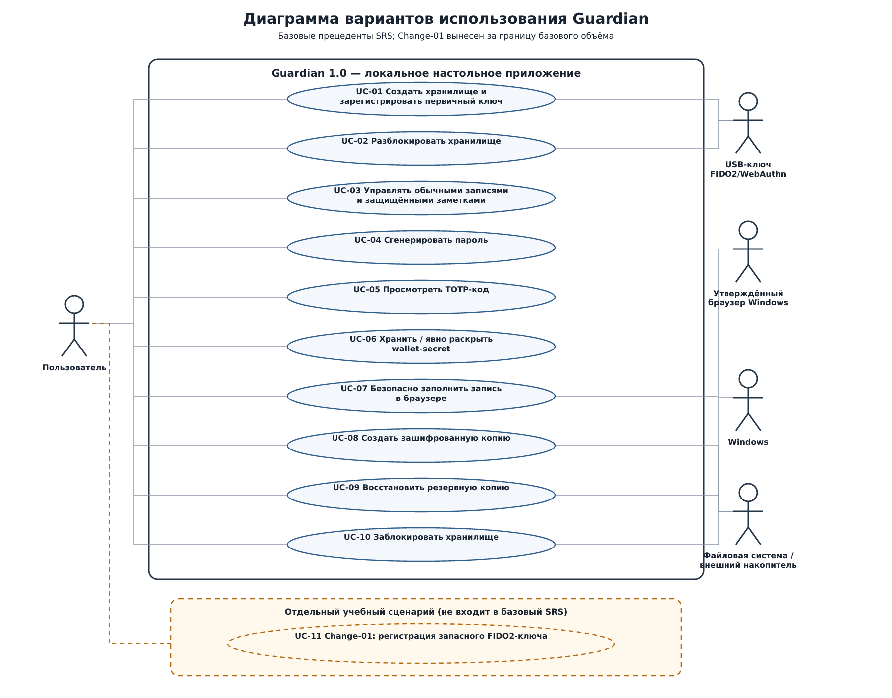
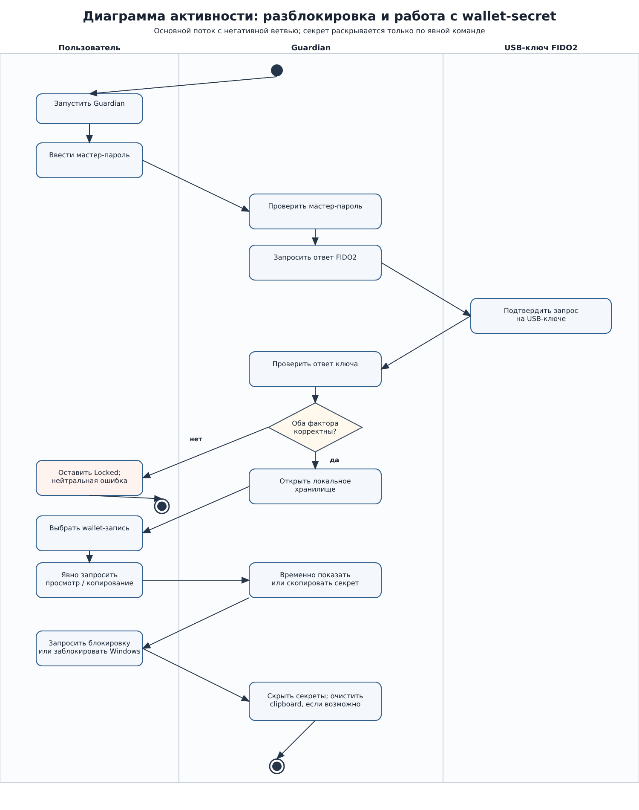
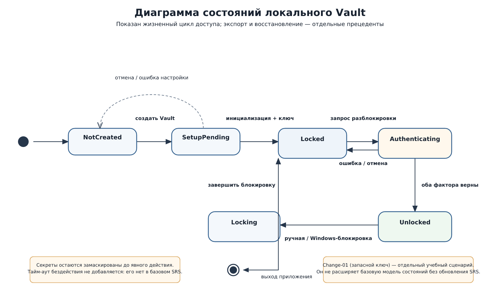
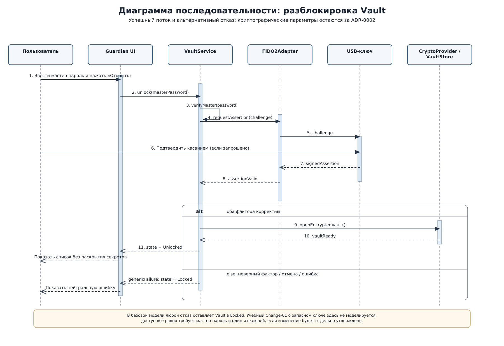

# Министерство образования Республики Беларусь

## Учреждение образования

**«БЕЛОРУССКИЙ ГОСУДАРСТВЕННЫЙ УНИВЕРСИТЕТ ИНФОРМАТИКИ И РАДИОЭЛЕКТРОНИКИ»**

Факультет компьютерных систем и сетей

Кафедра электронных вычислительных машин

Дисциплина: «Жизненный цикл разработки программного обеспечения»

# ОТЧЁТ

## по лабораторной работе № 5

### на тему «МОДЕЛИРОВАНИЕ ДИНАМИЧЕСКОГО ПОВЕДЕНИЯ СИСТЕМЫ НА ЯЗЫКЕ UML»

**Студент:** Д.А. Муравьёв

**Преподаватель:** Д.В. Куприянова

Минск 2026

---

# 1 ЦЕЛЬ И ЗАДАЧИ

Цель работы — изучить основные сведения о языке UML и освоить моделирование динамического поведения системы на основе требований и архитектурной документации проекта Guardian.

Задачи работы:

1. Разработать глоссарий Guardian и дополнительные спецификации в отдельных файлах.
2. Определить актёров и варианты использования, подготовить описания потоков событий.
3. Построить диаграммы вариантов использования, активности, состояний и последовательности.
4. Связать диаграммы с SRS и обновить SDD.
5. Зафиксировать обоснование подхода и границы моделей в ADR.
6. Составить план реализации ключевого поведения Guardian без фиксации неподтверждённых криптографических решений.
7. Подготовить материалы в репозитории Git и ответить на контрольные вопросы.

# 2 КРАТКИЕ ТЕОРЕТИЧЕСКИЕ СВЕДЕНИЯ

## 2.1 Объектно-ориентированный анализ и проектирование

Объектно-ориентированный анализ и проектирование (ООАП, OOA/D) — подход к разработке, при котором предметная область и поведение системы моделируются через объекты, их состояния, операции и взаимодействия. До реализации уточняются роли компонентов и связи между ними; это позволяет проверить модель и требования до написания основного кода.

UML (Unified Modeling Language) — стандартизированный графический язык для визуализации, спецификации и документирования программных систем. UML не является языком программирования и сам по себе не задаёт реализацию; диаграммы должны быть согласованы с требованиями и проектными решениями.

## 2.2 Диаграммы поведения

Диаграмма вариантов использования показывает внешних актёров, границу системы и доступные им цели. Диаграмма активности описывает поток действий и ветвления внутри сценария. Диаграмма состояний показывает жизненный цикл объекта и допустимые переходы. Диаграмма последовательности отображает участников взаимодействия и сообщения в хронологическом порядке.

Эти представления дополняют друг друга: use-case отвечает на вопрос «кто и зачем использует систему», activity — «как выполняется поток действий», state machine — «в каком состоянии находится объект и как оно меняется», sequence — «какие компоненты обмениваются сообщениями».

## 2.3 Поток событий

Спецификация прецедента содержит назначение, актёров, предусловия, основной поток, альтернативные/ошибочные потоки и постусловия. Основной поток описывает успешное выполнение цели; альтернативные потоки фиксируют отмену, ошибку или отклонение от нормального сценария. Спецификация нужна для уточнения диаграммы и подготовки проверяемых тестов.

# 3 ОПИСАНИЕ ВЫПОЛНЕННОГО ЗАДАНИЯ

## 3.1 Глоссарий и дополнительные спецификации

Подготовлен отдельный [`глоссарий Guardian`](glossary.md), включающий термины Vault, мастер-пароль, FIDO2/WebAuthn, wallet-data, seed-фраза, TOTP, автозаполнение и резервная копия. Отдельный файл [`дополнительных спецификаций`](specs/additional-specifications.md) фиксирует границы продукта, правила обработки секретов, интеграционные ограничения, ошибки и проверяемые результаты.

Модель основана на Guardian 1.0 из SRS: локальное приложение Windows, без серверной части, облачной синхронизации и операций с блокчейном. Seed-фразы и приватные ключи только вручную предоставляются пользователем и хранятся локально в зашифрованном виде. Конкретные алгоритмы шифрования, библиотека и протокол интеграции остаются на PoC и security review согласно ADR-0002.

## 3.2 Актёры и варианты использования

Основные актёры — Пользователь, USB-ключ FIDO2/WebAuthn, утверждённый браузер Windows, Windows и файловая система/внешний накопитель. Пользователь управляет локальным Vault; ключ участвует в аппаратной аутентификации; браузер получает только явно выбранные поля после проверки источника; Windows предоставляет локальные системные интерфейсы; файловая система используется для ручного экспорта и восстановления.

В модели определены десять базовых прецедентов: создание хранилища, разблокировка, управление обычными записями, генерация пароля, просмотр TOTP, работа с wallet-secret, безопасное автозаполнение, создание копии, восстановление и блокировка. Подробные описания актёров, предусловий, основных и альтернативных потоков, постусловий и трассировки к REQ приведены в отдельном файле [`use-cases.md`](specs/use-cases.md).

Диаграмма вариантов использования показывает границу Guardian и внешние интеграции. UC-11 о регистрации запасного FIDO2-ключа вынесен отдельно как учебный Change-01 из лабораторной работы №4; он не включён в базовый SRS.

**Рисунок 3.2.1 — Диаграмма вариантов использования Guardian**

## 3.3 Диаграмма активности

Для activity-диаграммы выбран сквозной сценарий разблокировки и явной работы с wallet-secret. Пользователь вводит мастер-пароль; Guardian проверяет его и запрашивает подтверждение FIDO2-ключа. Только после успешной проверки обоих факторов хранилище становится доступным. При ошибке или отмене Vault остаётся заблокированным. Wallet-secret можно показать или скопировать только после отдельного действия пользователя; блокировка скрывает секреты и запускает очистку clipboard, если это поддерживает Windows.

Диаграмма включает положительную и негативную ветви. Она не предполагает автоматический тайм-аут бездействия: такого численного требования нет в базовом SRS.

**Рисунок 3.3.1 — Диаграмма активности разблокировки и работы с wallet-secret**

## 3.4 Диаграмма состояний

Диаграмма состояний построена для объекта Vault и отражает его жизненный цикл: `NotCreated`, `SetupPending`, `Locked`, `Authenticating`, `Unlocked`, `Locking`. Из `Authenticating` система переходит в `Unlocked` только после успешной проверки мастер-пароля и зарегистрированного ключа. Любой отказ или отмена возвращает систему в `Locked`. Ручная блокировка или блокировка/выход из сеанса Windows переводят Vault через `Locking` в `Locked`.

Экспорт и восстановление показаны как отдельные пользовательские сценарии, а не как состояния Vault. Регистрация запасного ключа остаётся отдельным Change-01 и не меняет базовую диаграмму.

**Рисунок 3.4.1 — Диаграмма состояний локального Vault**

## 3.5 Диаграмма последовательности и обновление SDD/ADR

Диаграмма последовательности раскрывает внутреннее взаимодействие при разблокировке: UI передаёт запрос VaultService; проверяются мастер-пароль и FIDO2-ответ; затем CryptoProvider/VaultStore открывает локальное хранилище. На альтернативной ветви при неверном факторе, отмене или ошибке возвращается нейтральный отказ, а состояние остаётся `Locked`.

В SDD добавлено представление `DES-DYN-001` с идентификаторами use-case, activity, state machine и sequence-представлений и трассировкой к SRS. ADR-0004 объясняет выбор набора диаграмм, их связи и ограничения. ADR-0002 остаётся источником для выбора криптографической схемы после PoC и ревью безопасности; диаграмма не утверждает алгоритмы или параметры.

**Рисунок 3.5.1 — Диаграмма последовательности разблокировки Vault**

## 3.6 План разработки основного функционала

С учётом V3 из лабораторной работы №4 основной учебный сценарий рассчитан на 8 недель и 178 ч-д: 168 ч-д базового Guardian и 10 ч-д Change-01 (6 ч-д junior и 4 ч-д senior/QA/security). Смета 20 000 BYN является сценарной оценкой, а не подтверждённой коммерческой ценой. Change-01 остаётся отдельным сценарием и не меняет базовый SRS. Основную реализацию целесообразно выполнять короткими проверяемыми шагами:

1. Реализовать модель состояний Vault и тесты переходов `Locked → Authenticating → Unlocked` и блокировки; UI не должен обращаться к секретам при состоянии `Locked`.
2. Определить через PoC совместимые FIDO2 и криптографические библиотеки, зафиксировать версии и границы адаптеров; не реализовывать собственную криптографию.
3. Реализовать локальные операции записей с маскированием секретов и отдельным действием раскрытия/копирования; включить negative-тесты для отказов аутентификации и ошибок сохранения.
4. Отдельно проверить ручное резервирование и восстановление, включая wallet-secrets и отказ для повреждённой копии.
5. После выбора поддерживаемой браузерной матрицы реализовать автозаполнение с проверкой scheme/host/effective port и повторной проверкой после redirect.
6. Перед выпуском провести обязательные security- и regression-проверки и документировать подтверждённые решения в SDD/ADR.

Это план последующей реализации, а не утверждение о наличии готовой криптографической или FIDO2-реализации в репозитории. Параметры криптографии, UI-фреймворк, поддерживаемая браузерная матрица и процедура восстановления после утраты всех ключей остаются открытыми решениями.

## 3.7 Фиксация результатов в Git

В репозитории подготовлены отдельные файлы глоссария, дополнительных спецификаций и use-case потоков, исходники UML, SVG/PNG диаграммы, обновления SDD и ADR-0004. При изменении требований следует обновлять трассировку, диаграммы и тестовые сценарии согласованно; Change-01 не переносится в базовый SRS без отдельного решения.

# 4 ОТВЕТЫ НА КОНТРОЛЬНЫЕ ВОПРОСЫ

## 4.1 Что представляет собой методология объектно-ориентированного программирования? Чем она отличается от процедурной?

ООП организует программу вокруг объектов, которые объединяют состояние и поведение, а взаимодействие строится через интерфейсы объектов. Процедурный подход организует программу преимущественно вокруг функций и последовательности операций над данными. ООП облегчает моделирование предметной области и локализацию ответственности; процедурный подход часто проще для небольших алгоритмических задач. Оба подхода могут сочетаться.

## 4.2 Как понимается понятие «абстракция»?

Абстракция выделяет существенные свойства объекта для конкретной задачи и скрывает детали, которые не влияют на рассматриваемое поведение. Например, для use-case модели USB-ключ представлен ролью аппаратного фактора, а внутреннее устройство ключа не описывается.

## 4.3 Каковы основные принципы ООП?

Основные принципы — абстракция, инкапсуляция, наследование и полиморфизм. Абстракция выделяет существенное; инкапсуляция защищает состояние за интерфейсом; наследование позволяет строить специализированные типы на основе общих; полиморфизм позволяет обращаться к разным реализациям через общий контракт.

## 4.4 Что представляет собой класс и что такое объект?

Класс — описание общих данных и поведения некоторого типа. Объект — конкретный экземпляр класса с собственным состоянием. Например, `Vault` может быть классом, а созданное локальное хранилище конкретного пользователя — его объектом.

## 4.5 Приведите пример наследования.

Можно определить абстрактный класс `VaultRecord` с общими полями идентификатора и названия, а классы `PasswordRecord` и `WalletRecord` наследовать от него. В Guardian этот пример является иллюстративным; SRS/ADR ещё не выбирают модель wallet-data как отдельный класс или тип записи.

## 4.6 Что характеризует принцип инкапсуляции?

Инкапсуляция ограничивает прямой доступ к внутренним данным объекта и предоставляет операции через контролируемый интерфейс. Например, UI должен обращаться к секрету через Vault Service и только после явного действия, а не читать незашифрованное поле хранилища напрямую.

## 4.7 Что понимается под полиморфизмом?

Полиморфизм позволяет разным классам предоставлять реализацию общего интерфейса, сохраняя единый способ вызова. Например, разные реализации интерфейса `Authenticator` могут обращаться к различным поддерживаемым FIDO2-устройствам, не меняя прикладной сценарий.

## 4.8 Что такое ООАП (OOA/D)?

OOA/D — объектно-ориентированный анализ и проектирование. Анализ выявляет объекты, роли и поведение предметной области; проектирование уточняет программные компоненты, интерфейсы и взаимодействия для реализации.

## 4.9 Что такое UML и для чего он нужен?

UML — унифицированный язык моделирования программных систем. Он нужен для визуализации, спецификации и документирования требований и проектных решений, а также для согласования понимания между заказчиком, архитектором, разработчиками и QA.

## 4.10 Какие диаграммы UML отражают статическую структуру, а какие — динамику?

Структуру показывают, например, диаграммы классов, компонентов и развёртывания. Поведение показывают диаграммы вариантов использования, активности, состояний и взаимодействия (в том числе последовательности). Отдельные типы диаграмм акцентируют разные уровни описания системы.

## 4.11 Каковы основные элементы диаграммы вариантов использования?

Актёры, прецеденты, граница системы и связи. Актёр — внешняя роль, овал прецедента обозначает цель взаимодействия, рамка задаёт границу проектируемой системы. Связи actor–use case показывают участие актёра; `include`, `extend` и обобщение применяются, когда их семантика действительно нужна.

## 4.12 Каковы основные элементы диаграммы последовательности?

Участники/линии жизни, временная ось сверху вниз, сообщения-вызовы, ответы, полосы активности и комбинированные фрагменты `alt`, `opt`, `loop`. Диаграмма показывает порядок обмена сообщениями для выбранного сценария.

## 4.13 Каковы основные элементы диаграммы состояний?

Состояния объекта, начальное и конечное псевдосостояния, переходы, события и условия/guards. Переход фиксирует, при каком событии и условии объект меняет состояние; диаграмма помогает исключать недопустимые переходы.

## 4.14 Каковы основные элементы диаграммы активности?

Действия, начальный и конечный узлы, потоки управления, решения и слияния, а при необходимости fork/join и дорожки ответственности (swimlanes). Она показывает последовательность работы и разветвления процесса.

## 4.15 Что такое поток событий и из каких элементов он состоит?

Поток событий — текстовое описание выполнения прецедента. Обычно он содержит назначение/краткое описание, актёров, предусловия, основной поток, альтернативные и ошибочные ветви, постусловия.

## 4.16 Какие типы связей между элементами use-case диаграммы поддерживает UML?

Ассоциация связывает актёра с прецедентом; `include` означает обязательное включение повторно используемого поведения; `extend` добавляет условное поведение к базовому прецеденту; обобщение показывает специализацию актёра или прецедента. Тип связи выбирают по смыслу, а не ради усложнения схемы.

## 4.17 Почему обычно не моделируют связи между актёрами?

Диаграмма вариантов использования описывает взаимодействие внешних ролей с проектируемой системой, а не взаимодействия актёров друг с другом. Связь между актёрами оправдана, когда она является обобщением/специализацией ролей и помогает показать общий набор прецедентов; обычную коммуникацию между людьми лучше описывать вне use-case диаграммы.

# ЗАКЛЮЧЕНИЕ

В ходе лабораторной работы изучены принципы объектно-ориентированного анализа и моделирования динамического поведения на UML. На основе SRS Guardian определены актёры и пользовательские цели, подготовлены отдельные глоссарий и дополнительные спецификации.

Построены диаграммы вариантов использования, активности, состояний и последовательности. Они описывают локальную границу Guardian, двухфакторную разблокировку, явную работу с wallet-secret и блокировку Vault; негативная ветвь оставляет хранилище закрытым. Модели трассированы к SRS, добавлены в SDD, а выбор набора представлений и границы Change-01 зафиксированы в ADR-0004.

Результат предоставляет основу для последующей реализации и тестирования: сначала следует проверить состояния Vault и отказы аутентификации, затем согласовать FIDO2/криптографические библиотеки через PoC, реализовать локальные операции и резервное копирование, а после выбора браузерной матрицы — безопасное автозаполнение. Учебный Change-01 о запасном ключе остаётся отдельным сценарием и не изменяет базовый SRS.
