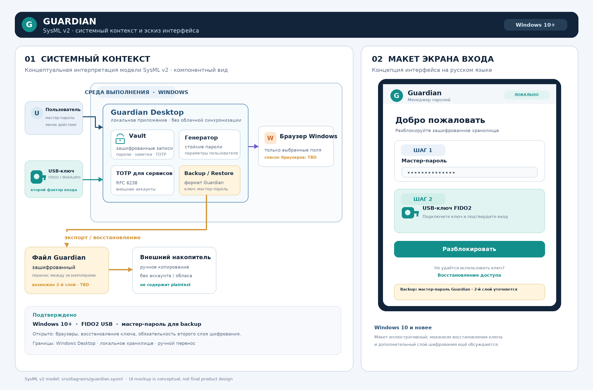

# Software Requirements Specification
## For Guardian — Password Manager

Version 0.2<br>
Prepared by Not specified  
Organization not specified  
2026-10-26

## Table of Contents
<!-- TOC -->
* [1. Introduction](#1-introduction)
    * [1.1 Document Purpose](#11-document-purpose)
    * [1.2 Product Scope](#12-product-scope)
    * [1.3 Definitions, Acronyms, and Abbreviations](#13-definitions-acronyms-and-abbreviations)
    * [1.4 References](#14-references)
    * [1.5 Document Overview](#15-document-overview)
* [2. Product Overview](#2-product-overview)
    * [2.1 Product Perspective](#21-product-perspective)
    * [2.2 Product Functions](#22-product-functions)
    * [2.3 Product Constraints](#23-product-constraints)
    * [2.4 User Characteristics](#24-user-characteristics)
    * [2.5 Assumptions and Dependencies](#25-assumptions-and-dependencies)
    * [2.6 Apportioning of Requirements](#26-apportioning-of-requirements)
* [3. Requirements](#3-requirements)
    * [3.1 External Interfaces](#31-external-interfaces)
    * [3.2 Functional](#32-functional)
    * [3.3 Quality of Service](#33-quality-of-service)
    * [3.4 Compliance](#34-compliance)
    * [3.5 Design and Implementation](#35-design-and-implementation)
    * [3.6 AI/ML](#36-aiml)
* [4. Verification](#4-verification)
* [5. Appendixes](#5-appendixes)
<!-- TOC -->

## Revision History

| Name | Date | Reason For Changes | Version |
|------|------|--------------------|---------|
| Not specified | 2026-10-26 | Initial SRS draft for Guardian | 0.1 |
| Project team | 2026-10-26 | Confirmed Windows 10+, FIDO2 USB key, master-password backup, and SysML v2 visual specification | 0.2 |

## 1. Introduction

This document specifies the requirements for Guardian, an application for securely managing passwords and related secrets. It defines the intended capabilities, first-release boundaries, constraints, quality attributes, and verification methods; it does not prescribe the internal architecture except for the explicit requirement to use Java. The document is intended for the product owner, developers, testers, and security specialists. Confirmed decisions and remaining assumptions are distinguished in Sections 2.5 and 5.1.

### 1.1 Document Purpose

This SRS defines **what** Guardian must do and the criteria for accepting the result. The product owner uses it to agree on scope; developers use it for design and implementation; QA and security specialists use it to prepare verification and analyze risks. Architectural decisions and specific cryptographic parameters must be documented separately and are not established by this document.

### 1.2 Product Scope

Guardian (release 1.0) is a Windows desktop password manager targeting Windows 10 and later. It lets users create and store encrypted records containing usernames, passwords, website addresses, notes, and TOTP secrets; organize and search records; generate passwords; and autofill credentials in supported Windows browsers. Unlocking the vault requires a master password and an enrolled FIDO2/WebAuthn USB security key; the application also generates TOTP codes for external services. To recover data or move it between Guardian instances, the user creates an encrypted backup file and stores it independently, including on removable media; Guardian accounts and cloud synchronization are not used. The application shall be implemented in Java, with no specific JDK version mandated by the product owner.

**In scope:** a Windows desktop application; a local encrypted vault; mandatory two-factor unlock; password, note, and TOTP-secret records; categories, search, and password generation; autofill in approved Windows browsers; and export/restore of an encrypted Guardian backup for transfer between Guardian instances and storage on removable media.

**Out of scope for release 1.0:** mobile applications and applications for other operating systems, a Guardian account, cloud or automatic synchronization, shared/enterprise vaults, imports from third-party managers, unencrypted exports to generic formats, operator-assisted secret recovery, and AI features. The exact supported Windows releases and autofill browsers shall be listed in a platform matrix before release.

### 1.3 Definitions, Acronyms, and Abbreviations

| Term | Definition |
|---|---|
| Autofill | Transfer of credentials selected by the user into a login field on a supported website or application. |
| Encrypted vault / vault | A set of user records saved in encrypted form. |
| Master password | A secret set by the user to unlock the vault; it must not be stored in plaintext. |
| TOTP | Time-Based One-Time Password — a one-time code calculated using a secret and the current time. |
| MFA / 2FA | Multi-factor / two-factor authentication. Guardian requires a master password and a FIDO2/WebAuthn USB security key for unlock; TOTP codes for external accounts are separate. |
| FIDO2/WebAuthn USB security key | A hardware key enrolled as the second factor for Guardian sign-in. Recovery after loss remains to be approved. |
| SRS | Software Requirements Specification — a specification of software requirements. |
| Java | The programming language and runtime required for Guardian implementation by the original request. |

### 1.4 References

| Title | Owner | Version / Date | Location | Status and Application |
|---|---|---|---|---|
| SRS template | Project repository | Repository version as of 2026-10-26 | `srs/srs-template-en.md` | Informative: structure and preparation guidance. |
| RFC 6238, TOTP: Time-Based One-Time Password Algorithm | IETF | RFC 6238, 2011-05 | https://www.rfc-editor.org/rfc/rfc6238 | Normative for TOTP generation compatibility and test vectors. |
| OWASP Application Security Verification Standard (ASVS) | OWASP Foundation | 5.0.0, 2025 | https://owasp.org/www-project-application-security-verification-standard/ | Informative security checklist; Guardian compliance is not claimed pending a separate assessment. |
| ISO/IEC/IEEE 29148, Systems and software engineering — Requirements engineering | ISO / IEC / IEEE | 29148:2018 | `docs/standards.md` | Informative requirements-engineering reference; formal conformance is not claimed. |
| Java Platform, Standard Edition Documentation | Oracle / OpenJDK | Target JDK release and documentation date to be fixed after release selection | https://docs.oracle.com/en/java/javase/ | Normative after the supported JDK is approved. |

### 1.5 Document Overview

Section 2 defines the product context, user classes, constraints, assumptions, and release allocation. Section 3 contains interface, functional, quality, and implementation requirements; mandatory statements use “shall,” and each requirement has a unique ID and acceptance criteria. Section 4 maps requirements to verification methods and artifacts, while Section 5 records open questions and draft limitations. Changes are approved by the product owner and, where applicable, the security specialist, and are recorded in the revision history.

---

## 2. Product Overview

### 2.1 Product Perspective

Guardian is a Windows desktop application for an individual user on Windows 10 and later, replacing password storage in notes, browser forms, and spreadsheets. It stores data locally and interacts with Windows and supported browsers only for autofill, clipboard access, file dialogs, and session locking. There is no network account or synchronization service; the user transfers data using an encrypted Guardian backup file. A product owner and support function must be assigned before release; a network SLA does not apply to the offline product, and support staff must not access secrets.

```text
User ──> Guardian (interface, encrypted vault, generator, TOTP)
                    │
                    └──> Supported browser/application (autofill only)
```

### 2.2 Product Functions

- Create, two-factor unlock, lock, and delete a personal vault.
- Add, view, edit, and delete records containing credentials and notes.
- Organize records into user-defined categories and search permitted metadata.
- Generate random passwords using parameters selected by the user.
- Autofill credentials in supported environments after checking the record’s source match.
- Store TOTP secrets and display current one-time codes.
- Prevent accidental disclosure through secret masking, automatic locking, and clipboard clearing.
- Create an encrypted backup file and restore/transfer data between Guardian instances; the user may store the file on removable media.

### 2.3 Product Constraints

| ID | Constraint |
|---|---|
| CON-01 | Guardian shall be a Windows 10-or-later desktop application; mobile versions and separate applications for other operating systems are out of scope for release 1.0. |
| CON-02 | Application logic shall be implemented in Java. The product owner does not mandate a specific Java/JDK release; the team shall select and pin a supported release before building a release artifact. |
| CON-03 | Secret fields in the local vault and backup files shall be encrypted; the master password, key, and Guardian authentication factor shall not be stored in plaintext. The backup shall use the Guardian password (master password), with no separate backup password; an additional encryption layer may be considered in the design decision. |
| CON-04 | Signing in to Guardian shall require a master password and a FIDO2/WebAuthn-compatible USB security key; TOTP secrets for external services are a separate feature. |
| CON-05 | Release 1.0 shall not include a Guardian account, cloud storage, or automatic synchronization; transfer between instances shall be manual through an encrypted Guardian file. |
| CON-06 | Import/export shall support only the Guardian backup format; plaintext exports to generic formats and imports from third-party managers are out of scope. |
| CON-07 | The release 1.0 interface and user documentation shall be in Russian; no other localization is required. |
| CON-08 | Specific cryptographic algorithms and parameters shall be selected and justified in design documentation using reviewed libraries; custom cryptography is prohibited without a separately approved exception. |
| CON-09 | Jurisdiction, applicable legal requirements, and licensing obligations shall be identified before public release. |
| CON-10 | Numerical performance targets and an automatic-lock inactivity interval are not release 1.0 acceptance criteria; they may be defined later from operational experience. |

### 2.4 User Characteristics

| User Class | Skills and Goals | Access |
|---|---|---|
| Vault owner | An ordinary user who wants to create, find, and use secrets without having to remember every password. May not have specialized cryptography knowledge. | Full access to their own vault after unlocking it. |
| Autofill user | Frequently signs in to websites/applications and expects to select an appropriate record without disclosing it to an unrelated source. | Selects and fills a matching record; a secret is revealed only after an explicit action. |
| Support engineer/developer | Maintains the application and diagnoses errors, but must not access user vault contents. | No routine access to user secrets. |

The release 1.0 interface and user documentation shall be in Russian only. Guardian targets Windows 10 and later; the interface shall support standard keyboard operation, Windows scaling, and system accessibility settings. Conformance to a specific accessibility standard remains to be confirmed before release.

### 2.5 Assumptions and Dependencies

| ID | Assumption / Dependency | Owner | Impact if False | Mitigation / Action |
|---|---|---|---|---|
| A-01 | Release 1.0 uses a local vault without a Guardian account or cloud/automatic synchronization; transfer is through a backup file. | Product owner (to be assigned) | Accounts, server-side services, conflict handling, and a new threat model would be required. | Baseline manual export/restore as the only transfer mechanism for release 1.0. |
| A-02 | The user must keep the master password and a spare USB key or other approved recovery credentials secure. | Product owner / UX (to be assigned) | Losing the master password or the only available recovery key may lock the user out. | Warn users when creating a vault and backup; do not promise operator recovery. |
| A-03 | The device runs Windows 10 or later in a configuration from the approved support matrix and is uncompromised. | User; security team owns threat-model disclosure | Protection against malware, keyloggers, and physical access to an unlocked device cannot be guaranteed. | Document assurance boundaries; perform threat analysis; lock the vault on Windows lock/sign-out. |
| A-04 | Supported Windows browsers will be selected for autofill, and the desktop-to-browser integration will be validated. | Product owner / tech lead (to be assigned) | Autofill testing and safe domain binding cannot be completed. | Approve a browser matrix before release; explicitly exclude unsupported browsers. |
| A-05 | Supported Java libraries for cryptography, TOTP, and secure random generation are available and pass security and license reviews. | Tech lead / security specialist (to be assigned) | Libraries or the Java runtime may need to change; custom cryptography would introduce unacceptable risk. | Select and review libraries during the PoC; pin Java/JDK before release build. |
| A-06 | The confirmed Guardian second factor is a FIDO2/WebAuthn USB security key; recovery after losing the key (spare key or another mechanism) has not yet been selected. | Project team / security specialist | Losing the only key may lock out the user. | Approve and verify a secure recovery flow before implementation. |
| A-07 | Windows system time is accurate enough to generate TOTP codes for external services. | User / platform-integration owner | External services may reject codes when the clock is wrong. | Use Windows system time and inform users of an evident time-synchronization issue. |
| A-08 | The backup file uses the Guardian password (master password), not a separate backup password; the user may store it on removable media. Whether an additional encryption layer is needed remains to be decided. | Project team / security specialist | Losing the master password may make the backup inaccessible; an extra layer may complicate recovery. | Do not store the password in the file; approve the cryptographic scheme and recovery UX before implementation. |

### 2.6 Apportioning of Requirements

| Area / Requirements | Subsystem or Increment | Status |
|---|---|---|
| REQ-FUNC-001–005, REQ-FUNC-008–010 | Release 1.0: local vault, records, categories, generation, notes, backup, and locking | Planned |
| REQ-FUNC-006–007, REQ-INT-003, REQ-SEC-005 | Release 1.0: autofill and TOTP for supported Windows browsers | Approve browser matrix |
| REQ-SEC-001–005, REQ-REL-001–002 | Release 1.0: data protection, MFA, locking, and recovery | Mandatory for release |
| REQ-INT-001–003, REQ-OBS-001 | Release 1.0: Windows interface, integrations, and safe diagnostics | Planned |
| REQ-AVAIL-001, REQ-COMP-001–002, REQ-INST-001, REQ-BUILD-001, REQ-MAINT-001, REQ-PORT-001, REQ-POC-001, REQ-CM-001 | Release 1.0: release readiness, operations, and proof of feasibility | Project decisions required |
| Automatic/cloud synchronization, accounts, sharing, other OSs, AI | Potential future releases | Out of scope for release 1.0; separate change requests |

The exact Windows releases and browsers remain in the platform matrix; numerical QoS targets are not release 1.0 acceptance criteria. Remaining decisions are listed in Section 5.1.

---

## 3. Requirements

Requirements shall be verifiable, unambiguous, and uniquely identified. “Shall” and “shall not” are mandatory for release 1.0 unless a requirement is marked as awaiting agreement. Numerical performance targets and an inactivity interval for automatic locking are not release 1.0 acceptance criteria (CON-10).

📃 Requirement template:
```markdown
- ID: REQ-FUNC-EXAMPLE
- Title: Short requirement title
- Statement: The system shall...
- Rationale: ...
- Acceptance Criteria: ...
- Verification Method: Test | Analysis | Inspection | Demonstration | Other
- More Information: Additional context or links
```

**Identifier scheme:** `REQ-[AREA]-[NNN]-[VER]`, where `-[VER]` is optional; identifiers are unique and immutable. Requirement changes are recorded in the document history. Each test artifact shall reference the applicable requirement ID.

### 3.1 External Interfaces

#### 3.1.1 User Interfaces

The interface shall let users manage the vault, records, categories, generator, and TOTP without manually editing files. Secrets shall be masked by default; revealing or copying them shall require an explicit user action. Errors during unlock, save, import/export, and autofill shall explain what happened without displaying secret values. The release 1.0 interface targets Windows 10 and later; keyboard navigation, Windows scaling, and system accessibility features shall be verified in a separate UX specification.

**Graphical specification (SysML v2 and UI mockup):** the figure shows Guardian boundaries, the FIDO2 USB key, browser integration, encrypted-file transfer, and an unlock-screen sketch. It is a conceptual illustration, not final design. Source model: `diagrams/guardian.sysml`.



*Figure 3.1. Conceptual SysML v2 system context and Guardian sign-in mockup. The interface labels are in Russian, as required for release 1.0.*

#### 3.1.2 Hardware Interfaces

Guardian shall support a FIDO2/WebAuthn USB security key for unlock. Installation shall run on Windows 10 and later with a compatible Java runtime selected by the team. No other specialized devices or biometric sensors are required.

#### 3.1.3 Software Interfaces

- Interaction with Windows browsers for autofill is permitted only through a supported and documented integration interface.
- The record format shall support a title, username, password, URL/source identifier, categories, notes, and optional TOTP data.
- An external network API, cloud synchronization, and third-party analytics SDKs are outside the scope of version 1.0.

```markdown
- ID: REQ-INT-001
- Title: Secret-management interface
- Statement: The user interface shall mask secret values by default and require an explicit user action to reveal, copy, or autofill a secret.
- Rationale: Prevents accidental disclosure during ordinary navigation.
- Acceptance Criteria: Passwords and TOTP secrets are not displayed in record lists; revealing/copying requires a separate action; interface errors contain no secret values.
- Verification Method: Inspection, functional test.
- More Information: CON-07; related: REQ-SEC-002.
```

```markdown
- ID: REQ-INT-002
- Title: External integration restrictions
- Statement: In release 1.0, the system shall not transmit vault data to external network services; local Windows and browser integration is permitted only for documented functions. A secret may be transferred to a browser only during user-initiated autofill.
- Rationale: Preserves the product’s local nature and limits the data-leak surface.
- Acceptance Criteria: Network-traffic analysis detects no outbound requests containing vault data; local Windows calls are limited to documented file selection, clipboard, session-locking, and autofill flows; the browser receives only user-selected fields in a confirmed target context.
- Verification Method: Traffic analysis, inspection.
- More Information: CON-05; related: REQ-AVAIL-001.
```

```markdown
- ID: REQ-INT-003
- Title: Secure autofill integration
- Statement: Integration with the selected browser or operating system shall transfer only fields from the record selected by the user to an explicitly confirmed target context.
- Rationale: Limits the data available to an external application.
- Acceptance Criteria: An integration test confirms that only selected fields are transferred and that unsupported or mismatched contexts are rejected.
- Verification Method: Integration test, demonstration.
- More Information: CON-01, assumption A-04; related: REQ-FUNC-006, REQ-SEC-005.
```

### 3.2 Functional

```markdown
- ID: REQ-FUNC-001
- Title: Vault creation and unlock
- Statement: The system shall allow the user to create a vault, set a master password, and unlock the vault only after verifying the master password and an enrolled FIDO2/WebAuthn USB security key.
- Rationale: The master password is the primary user method of accessing data.
- Acceptance Criteria: Records are available with a correct master password and second factor; if either factor is invalid, secret fields are not revealed and the application displays a neutral error message; the master password is not stored in plaintext.
- Verification Method: Test, analysis.
- More Information: CON-03, CON-04; related: REQ-SEC-001, REQ-SEC-002, REQ-FUNC-010.
```

```markdown
- ID: REQ-FUNC-002
- Title: Record management
- Statement: The system shall allow the user to add, view, edit, and delete a record containing a title, username, password, URL or other source identifier, and user-defined additional fields.
- Rationale: This is the core password-manager workflow.
- Acceptance Criteria: Saved changes persist after the application is closed and reopened; a deleted record is not displayed in the normal list; save failures do not cause partial or silent data loss.
- Verification Method: Functional test.
- More Information: CON-03; related: REQ-REL-001.
```

```markdown
- ID: REQ-FUNC-003
- Title: Categories, filtering, and search
- Statement: The system shall allow the user to assign records to user-defined categories and find records by title, username, category, or source address.
- Rationale: Categorization simplifies management of a growing vault.
- Acceptance Criteria: A category can be created, renamed, assigned, and deleted; deleting a category does not delete records; search results match the query and do not expose passwords.
- Verification Method: Functional test.
- More Information: CON-03.
```

```markdown
- ID: REQ-FUNC-004
- Title: Password generation
- Statement: The system shall generate a password from 8 to 128 characters long using user-selected character classes and a cryptographically secure random source provided by the Java runtime.
- Rationale: Random, unique passwords reduce guessing and reuse risks.
- Acceptance Criteria: The user can set the length and enable lowercase, uppercase, numeric, and special characters; if a class is selected, the result contains at least one character from each selected class; lengths 8 and 128 are supported and values outside the range are rejected; incompatible settings produce a clear error; testing confirms that no predictable random source is used.
- Verification Method: Test, analysis.
- More Information: CON-02, CON-08; related: REQ-POC-001.
```

```markdown
- ID: REQ-FUNC-005
- Title: Secure notes
- Statement: The system shall allow users to create and edit notes containing text related to the vault and shall store them with the same confidentiality protection as other secret data.
- Rationale: Users may need to protect information that is not a username or password.
- Acceptance Criteria: A note is available only after unlock; its contents do not appear in logs, external system search suggestions, or plaintext vault files.
- Verification Method: Functional test, inspection.
- More Information: CON-03; related: REQ-SEC-001, REQ-OBS-001.
```

```markdown
- ID: REQ-FUNC-006
- Title: Safe autofill
- Statement: The system shall offer autofill only for a record explicitly selected by the user and only when the scheme, host name, and effective port match the saved source; navigation to another source shall require revalidation.
- Rationale: Autofill must not send secrets to a lookalike or unrelated website.
- Acceptance Criteria: An exact source match is allowed; a lookalike domain, different port or scheme, or ambiguous URL is rejected; subdomains are not treated as matches automatically; filling occurs only after explicit user selection and the source is revalidated after redirects.
- Verification Method: Integration and negative testing.
- More Information: CON-01, assumption A-04; related: REQ-INT-003, REQ-SEC-005.
```

```markdown
- ID: REQ-FUNC-007
- Title: TOTP codes for saved accounts
- Statement: The system shall allow the user to add a TOTP secret to a record and shall display the current one-time code, its remaining validity time, and non-default algorithm parameters.
- Rationale: The user requested two-factor authentication support for external accounts.
- Acceptance Criteria: RFC 6238 test vectors produce the expected codes; defaults are 6 digits, a 30-second period, and HMAC-SHA-1; explicitly supplied parameters from a QR/otpauth URI or manual entry are supported; the TOTP secret is encrypted at rest and excluded from unencrypted export; remaining validity time is displayed.
- Verification Method: Test, analysis.
- More Information: CON-03; RFC 6238; related: REQ-SEC-001.
```

```markdown
- ID: REQ-FUNC-008
- Title: Backup and transfer between Guardian instances
- Statement: The system shall export the local vault to an encrypted file in Guardian’s proprietary format and restore it in another Guardian instance after user confirmation.
- Rationale: This gives the user an offline way to protect against data loss and manually transfer data between their Guardian instances, including storage on removable media.
- Acceptance Criteria: Export creates an encrypted file at a user-selected path, decryptable with the Guardian password (master password) and no separate backup password; restoring a verified backup returns records with their original values; a corrupted or unsupported backup, or an incorrect password, is rejected without overwriting the current vault; the file does not expose secret fields in plaintext; restore in a Guardian instance shall not bypass mandatory MFA and shall use an approved key check or re-enrollment flow. Whether to add a second encryption layer and whether MFA settings are included in the file shall be recorded in a design decision; generic formats and exchange with other password managers are not supported.
- Verification Method: Functional test, format inspection.
- More Information: CON-03, CON-05, CON-06; assumption A-08; related: REQ-SEC-001, REQ-REL-002.
```

```markdown
- ID: REQ-FUNC-009
- Title: Locking and revealing secrets
- Statement: The system shall let users lock the vault immediately, shall mask passwords and notes by default, and shall require an explicit action to reveal a secret.
- Rationale: This reduces the chance of accidental secret exposure.
- Acceptance Criteria: Record contents are unavailable through the interface after locking; a revealed secret is masked again when the record screen is left or the vault is locked.
- Verification Method: Functional test.
- More Information: CON-04, CON-10; related: REQ-SEC-003.
```

```markdown
- ID: REQ-FUNC-010
- Title: Mandatory two-factor authentication for Guardian
- Statement: The system shall require both master-password verification and an independent second factor for every vault unlock; access recovery is permitted only through a separately approved process that does not reduce to master-password-only verification.
- Rationale: This adds a factor to access to Guardian itself; it is separate from generating TOTP codes for external services.
- Acceptance Criteria: The user enrolls a FIDO2/WebAuthn USB security key during initial setup; secret records remain unavailable until the master password and key are successfully verified; a missing or invalid key does not unlock the vault; an approved recovery process for a lost key is verified before release; authentication data is protected according to the approved design and is not available in plaintext.
- Verification Method: Functional test, negative test, inspection.
- More Information: CON-04; assumption A-06; the second-factor type is confirmed; recovery after key loss remains to be decided.
```

### 3.3 Quality of Service

#### 3.3.1 Performance

No numerical performance targets or response-time acceptance criteria are set for release 1.0. Responsiveness is assessed through ordinary usability testing; quantitative targets may be agreed through a separate change after user feedback (CON-10).

#### 3.3.2 Security

```markdown
- ID: REQ-SEC-001
- Title: Vault encryption
- Statement: The system shall encrypt secret fields and backups using current, widely reviewed cryptographic mechanisms from a supported library; the specific algorithms, parameters, and key-management scheme shall be approved in design documentation before release.
- Rationale: Protects data confidentiality when device files or a backup are accessed.
- Acceptance Criteria: Inspection of configuration and format confirms encryption; reading the file without the key does not reveal secret-field contents; no custom cryptographic primitives are used without an approved exception.
- Verification Method: Analysis, inspection.
- More Information: CON-03, CON-08; cryptographic parameters require approval before release.
```

```markdown
- ID: REQ-SEC-002
- Title: Master-password and key protection
- Statement: The system shall not store the master password or decryption key in plaintext, and any derived values shall be stored only in a form approved by a security analysis.
- Rationale: Disclosure of an application or vault file must not directly reveal the access secret.
- Acceptance Criteria: The master password and key are absent from files, logs, crash reports, and telemetry; key-derivation parameters are documented and reviewed by a security specialist.
- Verification Method: Analysis, test.
- More Information: CON-03, CON-08; related: REQ-FUNC-001, REQ-OBS-001.
```

```markdown
- ID: REQ-SEC-003
- Title: Vault locking
- Statement: The system shall let the user lock the vault immediately and shall automatically lock it when the Windows session is locked or signed out.
- Rationale: This limits access to an open vault when the user stops working in the session.
- Acceptance Criteria: Manual locking immediately makes records unavailable; locking or signing out of Windows locks Guardian; reopening requires successful verification of the authentication factors. No inactivity interval is specified as a release 1.0 requirement.
- Verification Method: Functional test, Windows integration test.
- More Information: CON-04, CON-10; related: REQ-FUNC-009, REQ-FUNC-010.
```

```markdown
- ID: REQ-SEC-004
- Title: Clipboard clearing
- Statement: If the user copies a password to the clipboard, the system shall clear it when the vault is locked, if Windows permits clipboard control.
- Rationale: This reduces the time that another application can access a secret after vault use ends.
- Acceptance Criteria: Copying and clearing on lock are verified by an integration test on a supported configuration; if Windows does not permit clearing, the application warns before copying and provides an explicit clear action.
- Verification Method: Integration test, demonstration.
- More Information: CON-01, CON-03; clearing depends on Windows permissions.
```

```markdown
- ID: REQ-SEC-005
- Title: Autofill source verification
- Statement: The system shall allow autofill only when the scheme, host name, and effective port match the record source; the source shall be revalidated after redirects.
- Rationale: Protects against phishing and inadvertent password disclosure.
- Acceptance Criteria: Exact matches are allowed; lookalike domains, different ports or schemes, unknown domains, and ambiguous URLs are rejected; subdomains are not automatically treated as matches; negative tests confirm rejection in every disallowed case.
- Verification Method: Negative test, analysis.
- More Information: CON-01, A-04; related: REQ-FUNC-006, REQ-INT-003.
```

#### 3.3.3 Reliability

```markdown
- ID: REQ-REL-001
- Title: Integrity in case of failure
- Statement: The system shall save vault changes atomically to the extent supported by the selected format, so that an interrupted write does not cause silent loss or alteration of previously saved data.
- Rationale: Vault corruption may cause irrecoverable loss of secrets.
- Acceptance Criteria: An injected interruption during a save does not leave a partially accepted record; the application reports unreadable data and preserves the original file/copy for recovery.
- Verification Method: Fault-tolerance test.
- More Information: CON-03, CON-05; related: REQ-FUNC-002, REQ-FUNC-008.
```

```markdown
- ID: REQ-REL-002
- Title: Backup validation
- Statement: The system shall validate the integrity and format of a backup before restoration and shall not replace the active vault with unverified data.
- Rationale: Protects against corrupted, tampered, or incompatible backups.
- Acceptance Criteria: Corrupted and incorrectly authenticated backups are rejected; the original vault remains accessible.
- Verification Method: Negative test.
- More Information: CON-03, CON-05; related: REQ-FUNC-008.
```

#### 3.3.4 Availability

```markdown
- ID: REQ-AVAIL-001
- Title: Offline availability
- Statement: After installation and vault creation, the user shall be able to perform local operations without a network connection.
- Rationale: Passwords should remain available without a network, and the product has no external service dependency in release 1.0.
- Acceptance Criteria: Creation, unlock, search, editing, generation, TOTP, and local backup work in an isolated network; the application does not attempt to send vault contents over an external network.
- Verification Method: Isolated-environment test, network-traffic analysis.
- More Information: CON-05; related: REQ-INT-002.
```

#### 3.3.5 Observability

In release 1.0, remote telemetry, usage analytics, and trace collection are disabled; diagnostics are local and minimal. A diagnostic report may be exported only with the user’s explicit consent.

```markdown
- ID: REQ-OBS-001
- Title: Safe diagnostics
- Statement: The system shall provide local diagnostic messages about failures and operation status without passwords, the master password, TOTP secrets, notes, keys, or plaintext record contents; remote telemetry shall be disabled in release 1.0.
- Rationale: Diagnostics are needed to fix problems, but logs must not become a data-leak channel.
- Acceptance Criteria: Log and report inspection confirms the absence of secrets; URLs and usernames are masked or omitted; network monitoring detects no telemetry; export of a sanitized report requires explicit user consent.
- Verification Method: Inspection, test.
- More Information: CON-03, CON-05; related: REQ-SEC-002.
```

### 3.4 Compliance

```markdown
- ID: REQ-COMP-001
- Title: Dependency and license review
- Statement: Before release, the team shall inventory third-party libraries, record their versions and licenses, and check for known critical vulnerabilities.
- Rationale: Reduces legal and operational risks from dependencies.
- Acceptance Criteria: Each release includes a component list and review results; critical vulnerabilities are not released without documented risk acceptance.
- Verification Method: Release-artifact inspection.
- More Information: CON-09; legal jurisdiction remains an open question in Section 5.1.
```

```markdown
- ID: REQ-COMP-002
- Title: Identify applicable legal requirements
- Statement: Before public release, the product owner shall identify legal and regulatory requirements applicable to target jurisdictions, document applicability, and assign owners for compliance.
- Rationale: Requirements for personal data, consumer notices, accessibility, and software distribution depend on the release market.
- Acceptance Criteria: An approved compliance checklist identifies jurisdictions, applicable requirements, a control owner, and evidence for each control; any requirement deemed inapplicable has a documented rationale.
- Verification Method: Inspection.
- More Information: CON-09; target jurisdictions are an open question in Section 5.1.
```

Jurisdiction, accessibility, licensing, and distribution rules are deferred as nonessential to the current design stage. Applicable requirements must still be identified and reviewed before public release. This SRS makes no certification or legal-compliance claim; product, security, and legal-review owners have not yet been assigned.

### 3.5 Design and Implementation

#### 3.5.1 Installation

```markdown
- ID: REQ-INST-001
- Title: Supported installation
- Statement: A release shall include documented installation steps, Java runtime requirements, and a list of supported operating systems once these have been approved.
- Rationale: Users must be able to install the application without undocumented dependencies.
- Acceptance Criteria: A clean installation is verified on supported Windows 10 and later configurations; documentation lists Java runtime requirements; uninstall warns before data deletion and does not remove the vault without confirmation; the update rollback procedure preserves user data.
- Verification Method: Demonstration, inspection.
- More Information: CON-01, CON-02; the team selects the Java/JDK release before building a release artifact.
```

#### 3.5.2 Build and Delivery

```markdown
- ID: REQ-BUILD-001
- Title: Reproducible and verifiable delivery
- Statement: The team shall pin JDK and dependency versions, build release artifacts through an automated process, verify them, and publish artifact checksums and a digital release signature.
- Rationale: Provides release traceability and integrity.
- Acceptance Criteria: Each version has a version number, component/license list, checksums, a verifiable signature, and build instructions; the release passes automated tests and dependency checks; only a verified artifact is promoted between environments.
- Verification Method: Inspection, repeat build.
- More Information: CON-02; related: REQ-PORT-001.
```

#### 3.5.3 Distribution

Release 1.0 is intended to be installed and store data on the user’s device. Replication mechanisms, distributed servers, and horizontal scaling are not required. Any addition of network synchronization requires revisiting product scope, the threat model, and availability and confidentiality requirements.

#### 3.5.4 Maintainability

```markdown
- ID: REQ-MAINT-001
- Title: Documentation and change-impact analysis
- Statement: The codebase shall include build and test instructions, a description of the vault format, and cryptography design decisions; changes to the format or secret handling shall include an assessment of compatibility and data migration impact.
- Rationale: Safe changes require understanding their consequences for user vaults.
- Acceptance Criteria: Documentation is available in the repository; change review includes a migration test or a rationale for why one is unnecessary.
- Verification Method: Inspection.
- More Information: CON-05; related: REQ-SEC-001, REQ-REL-002.
```

#### 3.5.5 Reusability

Separate password-generation, serialization, and TOTP-processing components may be made reusable only if they have stable interfaces and independent tests. Publishing libraries or promising a stable external API is not required for release 1.0.

#### 3.5.6 Portability

```markdown
- ID: REQ-PORT-001
- Title: Java component compatibility with Windows
- Statement: Java components shall build and pass automated tests on the JDK release selected by the team for compatibility; Windows integrations shall be isolated from vault logic.
- Rationale: Ensures compatibility of the selected Java runtime with target Windows configurations and isolates system integration from vault logic.
- Acceptance Criteria: A compatible runtime is specified for supported Windows configurations; common tests pass without workarounds; Windows and browser integrations are tested separately.
- Verification Method: Build and test on supported Windows configurations.
- More Information: CON-01, CON-02; the team selects the Java/JDK release before building a release artifact.
```

#### 3.5.7 Cost

No budget, licensing model, or spending limit has been provided. In release 1.0, the product shall not depend on a paid external service for local vault access. Third-party library selection shall consider license obligations and support costs; financial targets will be added after the business model is agreed.

#### 3.5.8 Deadline

Milestone and release dates have not been defined. Milestone dependencies are: supported Windows releases, the autofill browser matrix, and a compatible JDK are selected; the PoC validates critical integrations and cryptographic assumptions; architecture and threat model are then baselined; the release candidate passes functional, integration, negative, and security tests, while responsiveness is assessed in usability testing without a numerical threshold. Release 1.0 readiness criteria are: no unresolved critical vulnerabilities without documented risk acceptance; backup and restore verified; installation, migration, and rollback instructions published; and release approval from the product owner and security specialist.

#### 3.5.9 Proof of Concept

```markdown
- ID: REQ-POC-001
- Title: Validation of critical technical risks
- Statement: Before the architecture is baselined, the team shall conduct a limited feasibility study of local-vault encryption, password generation, TOTP storage, unlock with a FIDO2/WebAuthn USB key, encrypted backup/restore, and safe autofill on Windows 10 and later.
- Rationale: Autofill and secure secret handling depend on the platform and need early validation.
- Acceptance Criteria: The PoC demonstrates vault creation and two-factor unlock; correct rejection of invalid credentials; encrypted backup/restore; test secrets absent from plaintext files and logs; rejection of an unsuitable autofill source; and documented results, limitations, and a go/revise decision. The schedule is set by project planning.
- Verification Method: Demonstration, analysis.
- More Information: CON-01, CON-03, CON-04, CON-08; results gate the architecture baseline.
```

#### 3.5.10 Change Management

Changes shall be classified as bug fixes, compatible additions, or breaking changes. Each change request shall be reviewed by the product owner; security and vault-format changes shall also be reviewed by the security specialist. Every approved change shall be recorded in the revision history and release notes; incompatible changes shall provide migration instructions and a rollback plan before installation.

```markdown
- ID: REQ-CM-001
- Title: Change control and communication
- Statement: The team shall classify, assess, approve, and document changes to Guardian requirements and releases before including each change in a release.
- Rationale: Controlled change management prevents data loss and unintended reduction in security.
- Acceptance Criteria: Each change records its category, security/compatibility impact assessment, approval by the product owner and, where applicable, the security specialist; format changes include migration and rollback plans; releases include a changelog and user guidance when needed.
- Verification Method: Inspection, analysis.
- More Information: Related to REQ-MAINT-001, REQ-SEC-001, and REQ-REL-002.
```

### 3.6 AI/ML

Guardian version 1.0 does not use machine learning or generative AI. These subsections are not applicable; adding AI in a future version will require a separate description of the model, data, guardrails, human oversight, and ethical-risk assessment.

#### 3.6.1 Model Specification

Not applicable: no ML models are included in release 1.0. The password generator is not an ML model and shall use a cryptographically secure random-number generator.

#### 3.6.2 Data Management

No data is collected or used for ML training. Vault secrets shall not be sent to train models or to external analytics services.

#### 3.6.3 Guardrails

ML guardrails are not applicable. Safety of actions and autofill is governed by REQ-SEC-004, REQ-SEC-005, and REQ-FUNC-006.

#### 3.6.4 Ethics

ML ethics assessment is not applicable because there are no ML components. The interface shall not mislead users about where a secret is sent or what guarantees the application provides.

#### 3.6.5 Human-in-the-Loop

There are no ML-driven decisions. Selecting a record for autofill and revealing a secret require explicit user action as specified by the functional requirements.

#### 3.6.6 Model Lifecycle and Operations

Not applicable: no models are deployed, retrained, or monitored.

---

## 4. Verification

Each requirement shall be verified on a supported Windows 10 and later configuration listed in the platform matrix before release. Security requirements require both positive and negative scenarios. Test data shall be synthetic and shall not contain real user secrets.

| Requirement ID | Verification Method | Test / Artifact | Status | Evidence |
|---|---|---|---|---|
| REQ-INT-001 | Inspection, functional test | Planned artifact: `tests/verification/REQ-INT-001.md` | Planned | — |
| REQ-INT-002 | Traffic analysis, inspection | Planned artifact: `tests/verification/REQ-INT-002.md` | Planned | — |
| REQ-INT-003 | Integration test, demonstration | Planned artifact: `tests/verification/REQ-INT-003.md` | Blocked by approval of the browser matrix | — |
| REQ-FUNC-001 | Test, analysis | Planned artifact: `tests/verification/REQ-FUNC-001.md` | Planned | — |
| REQ-FUNC-002 | Functional test | Planned artifact: `tests/verification/REQ-FUNC-002.md` | Planned | — |
| REQ-FUNC-003 | Functional test | Planned artifact: `tests/verification/REQ-FUNC-003.md` | Planned | — |
| REQ-FUNC-004 | Test, analysis | Planned artifact: `tests/verification/REQ-FUNC-004.md` | Planned | — |
| REQ-FUNC-005 | Test, inspection | Planned artifact: `tests/verification/REQ-FUNC-005.md` | Planned | — |
| REQ-FUNC-006 | Integration, negative test | Planned artifact: `tests/verification/REQ-FUNC-006.md` | Blocked by approval of the browser matrix | — |
| REQ-FUNC-007 | Test, analysis | Planned artifact: `tests/verification/REQ-FUNC-007.md` | Planned | — |
| REQ-FUNC-008 | Test, inspection | Planned artifact: `tests/verification/REQ-FUNC-008.md` | Planned | — |
| REQ-FUNC-009 | Functional test | Planned artifact: `tests/verification/REQ-FUNC-009.md` | Planned | — |
| REQ-FUNC-010 | Functional and negative test | Planned artifact: `tests/verification/REQ-FUNC-010.md` | Blocked by MFA-flow approval | — |
| REQ-SEC-001 | Analysis, inspection | Planned artifact: `tests/verification/REQ-SEC-001.md` | Planned | — |
| REQ-SEC-002 | Analysis, test | Planned artifact: `tests/verification/REQ-SEC-002.md` | Planned | — |
| REQ-SEC-003 | Test | Planned artifact: `tests/verification/REQ-SEC-003.md` | Planned | — |
| REQ-SEC-004 | Windows integration test | Planned artifact: `tests/verification/REQ-SEC-004.md` | Planned | — |
| REQ-SEC-005 | Negative test, analysis | Planned artifact: `tests/verification/REQ-SEC-005.md` | Blocked by approval of the browser matrix | — |
| REQ-REL-001 | Fault-tolerance test | Planned artifact: `tests/verification/REQ-REL-001.md` | Planned | — |
| REQ-REL-002 | Negative test | Planned artifact: `tests/verification/REQ-REL-002.md` | Planned | — |
| REQ-AVAIL-001 | Isolated-environment test | Planned artifact: `tests/verification/REQ-AVAIL-001.md` | Planned | — |
| REQ-OBS-001 | Inspection, test | Planned artifact: `tests/verification/REQ-OBS-001.md` | Planned | — |
| REQ-COMP-001 | Inspection | Planned artifact: `tests/verification/REQ-COMP-001.md` | Planned | — |
| REQ-COMP-002 | Inspection | Planned artifact: `tests/verification/REQ-COMP-002.md` | Planned | — |
| REQ-INST-001 | Demonstration, inspection | Planned artifact: `tests/verification/REQ-INST-001.md` | Blocked by approval of the Windows matrix | — |
| REQ-BUILD-001 | Inspection, repeat build | Planned artifact: `tests/verification/REQ-BUILD-001.md` | Planned | — |
| REQ-MAINT-001 | Inspection | Planned artifact: `tests/verification/REQ-MAINT-001.md` | Planned | — |
| REQ-PORT-001 | Windows build and test | Planned artifact: `tests/verification/REQ-PORT-001.md` | Blocked by approval of the Windows matrix | — |
| REQ-POC-001 | Demonstration, analysis | Planned artifact: `tests/verification/REQ-POC-001.md` | Planned | — |
| REQ-CM-001 | Inspection, analysis | Planned artifact: `tests/verification/REQ-CM-001.md` | Planned | — |

Test paths in the matrix are planned locations: artifacts shall be added to the repository with the tests; until created, status remains “Planned” or “Blocked” according to dependencies. Evidence shall link to a CI report or verification record.


---
## 5. Appendixes

### 5.1 Open Questions

1. Which Windows browsers will be included in the autofill matrix? The target OS is confirmed as Windows 10 and later.
2. Will recovery after losing the USB key use a spare FIDO2 key, another verified process, or both?
3. Will a second encryption layer for backup files be mandatory, optional, or excluded from release 1.0?

### 5.2 Draft Limitations

This SRS records the confirmed Windows desktop scope for release 1.0, mandatory 2FA for Guardian, Russian localization, manual encrypted-file transfer between Guardian instances, and Java implementation. The browser matrix, recovery after loss of a FIDO2 key, and whether to add a second encryption layer remain open. Legal requirements, licensing, and assignment of owners are deferred until preparation for public release. Numerical performance targets and an automatic-lock timer are not release 1.0 acceptance criteria.
