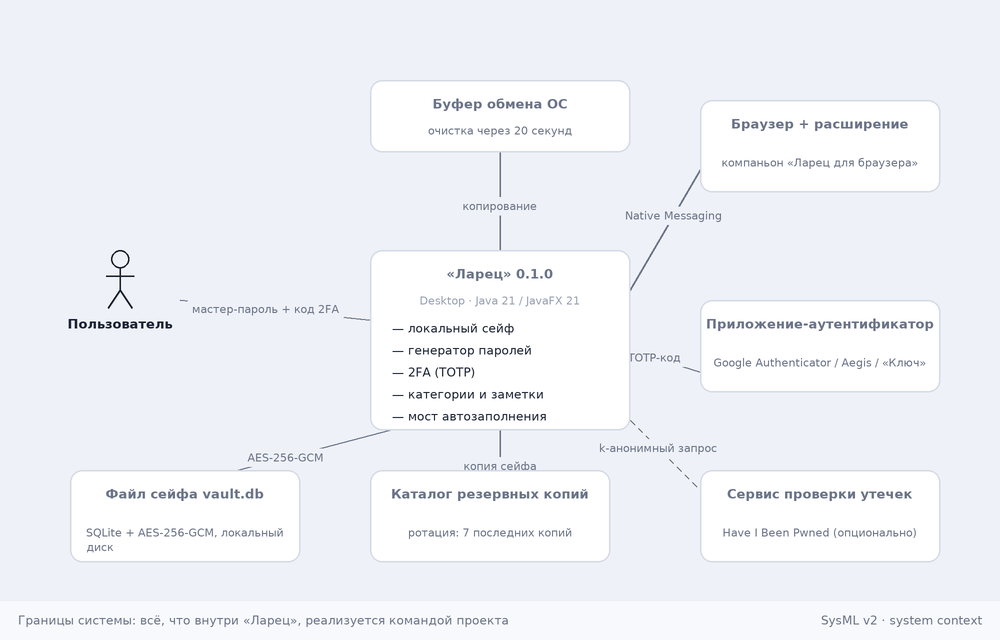
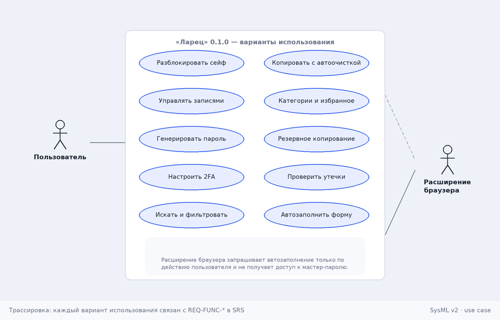
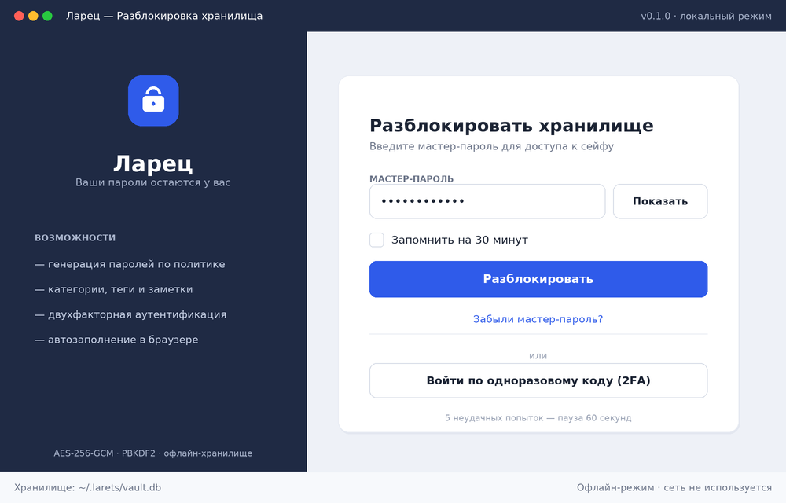
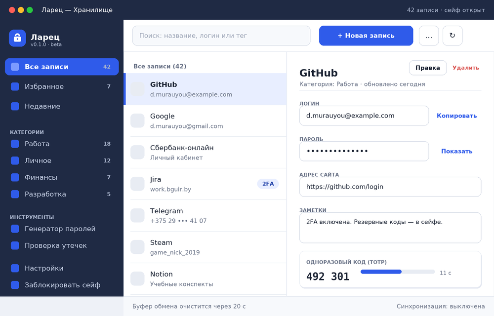
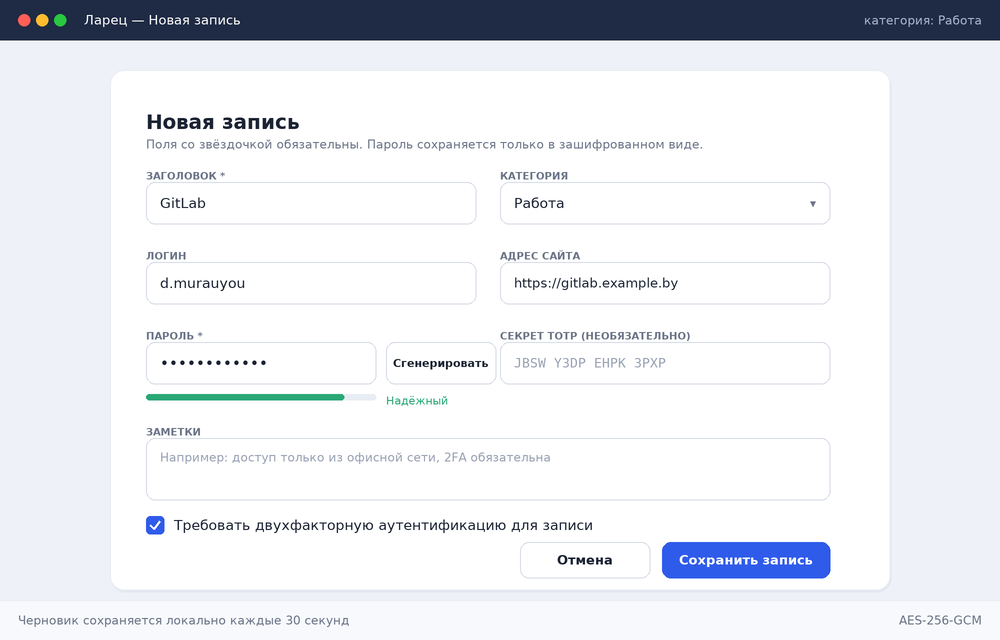
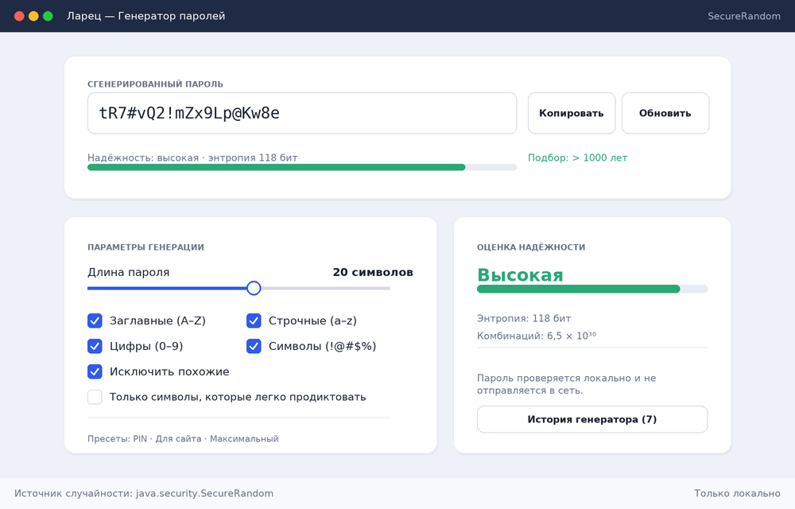
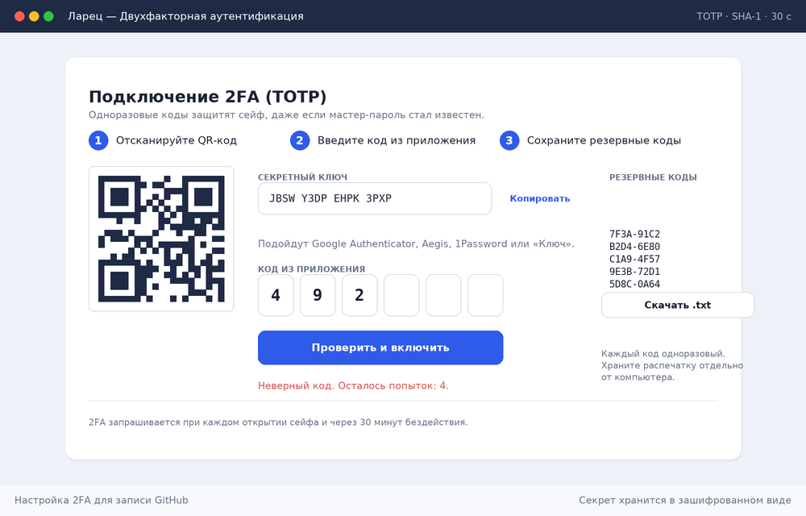
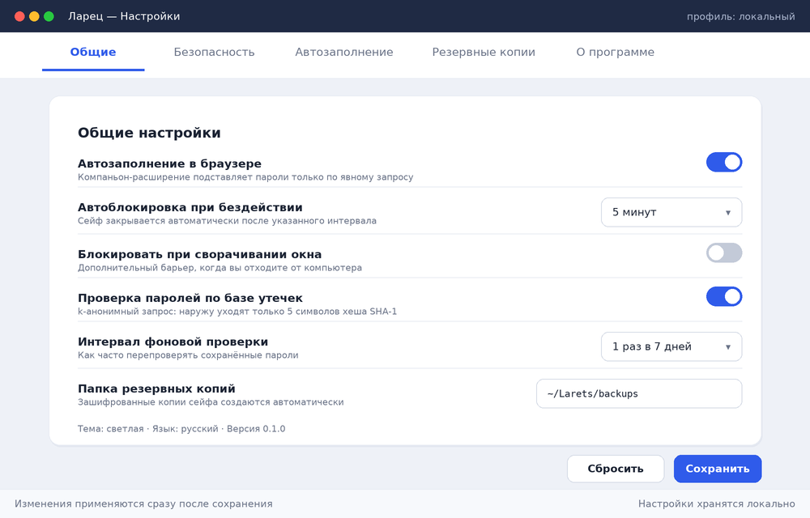

# Спецификация требований к ПО

Для проекта «Ларец» — локальный менеджер паролей

Версия 0.1

Подготовил(а) Муравьёв Дмитрий, группа 4101 (напарник: {{ФИО напарника — по распределению преподавателя}})

Кафедра ЭВМ, БГУИР · дисциплина «Жизненный цикл разработки программного обеспечения»

2026-10-25

> **Документ заменяет шаблон `srs/srs-template.md`, сохраняя его структуру.**  
> Репозиторий проекта: `dzmitry-murauyou/SDLC`, лабораторная работа №3.  
> Графические материалы (SysML v2 → PNG): каталог [`srs/mockups/`](mockups/),  
> исходные модели: [`srs/mockups/`](mockups/).

## Оглавление

<!-- TOC -->
* [1. Введение](#1-introduction)
  * [1.1 Назначение документа](#11-document-purpose)
  * [1.2 Область применения продукта](#12-product-scope)
  * [1.3 Определения, акронимы и сокращения](#13-definitions-acronyms-and-abbreviations)
  * [1.4 Ссылки](#14-references)
  * [1.5 Обзор документа](#15-document-overview)
* [2. Обзор продукта](#2-product-overview)
  * [2.1 Перспектива продукта](#21-product-perspective)
  * [2.2 Функции продукта](#22-product-functions)
  * [2.3 Ограничения продукта](#23-product-constraints)
  * [2.4 Характеристики пользователей](#24-user-characteristics)
  * [2.5 Допущения и зависимости](#25-assumptions-and-dependencies)
  * [2.6 Распределение требований](#26-apportioning-of-requirements)
* [3. Требования](#3-requirements)
  * [3.1 Внешние интерфейсы](#31-external-interfaces)
    * [3.1.1 Пользовательские интерфейсы](#311-user-interfaces)
    * [3.1.2 Аппаратные интерфейсы](#312-hardware-interfaces)
    * [3.1.3 Программные интерфейсы](#313-software-interfaces)
  * [3.2 Функциональные требования](#32-functional)
  * [3.3 Качество обслуживания](#33-quality-of-service)
    * [3.3.1 Производительность](#331-performance)
    * [3.3.2 Безопасность](#332-security)
    * [3.3.3 Надёжность](#333-reliability)
    * [3.3.4 Доступность](#334-availability)
    * [3.3.5 Наблюдаемость](#335-observability)
  * [3.4 Соответствие стандартам](#34-compliance)
  * [3.5 Проектирование и реализация](#35-design-and-implementation)
    * [3.5.1 Установка](#351-installation)
    * [3.5.2 Сборка и поставка](#352-build-and-delivery)
    * [3.5.3 Распределение](#353-distribution)
    * [3.5.4 Сопровождаемость](#354-maintainability)
    * [3.5.5 Повторное использование](#355-reusability)
    * [3.5.6 Переносимость](#356-portability)
    * [3.5.7 Стоимость](#357-cost)
    * [3.5.8 Сроки](#358-deadline)
    * [3.5.9 Доказательство концепции](#359-proof-of-concept)
    * [3.5.10 Управление изменениями](#3510-change-management)
  * [3.6 ИИ/МО](#36-aiml)
    * [3.6.1 Спецификация модели](#361-model-specification)
    * [3.6.2 Управление данными](#362-data-management)
    * [3.6.3 Ограничители (Guardrails)](#363-guardrails)
    * [3.6.4 Этика](#364-ethics)
    * [3.6.5 Human-in-the-Loop](#365-human-in-the-loop)
    * [3.6.6 Жизненный цикл модели и операции](#366-model-lifecycle-and-operations)
* [4. Верификация](#4-verification)
* [5. Приложения](#5-appendixes)
<!-- TOC -->

## История изменений

| Name | Date | Reason For Changes | Version |
|------|------|--------------------|---------|
| Д. Муравьёв | 2026-10-25 | Первая редакция бизнес-требований по итогам лабораторной работы №3: выбраны вариант приложения и тип проекта, получены требования Заказчика, подготовлены GUI-мокапы на SysML v2 | 0.1 |
|      |      |                    |         |

---

## 1. Введение {#1-introduction}

Документ фиксирует бизнес-требования к desktop-приложению «Ларец» — локальному менеджеру паролей, которое студенческая команда разрабатывает в течение семестра по дисциплине «Жизненный цикл разработки ПО». Разделы 1–2 задают контекст и границы продукта, раздел 3 — проверяемые требования, раздел 4 — способы их верификации, раздел 5 — приложения с графическими материалами.

### 1.1 Назначение документа {#11-document-purpose}

SRS описывает **что** должна делать система «Ларец» версии 0.1.0 и почему эти возможности нужны Заказчику; **как** они будут реализованы, описывается отдельно в SDD. Документ используют: Заказчик — для приёмки бизнес-требований и приоритизации; команда разработки (2 человека) — для планирования итераций и проектирования; роль QA — для построения матрицы верификации (раздел 4); руководитель курсового проекта — для оценки полноты и качества инженерных артефактов. Документ является нормативным для всех последующих артефактов ЖЦ: дизайна (SDD), архитектурных решений (ADR), тест-плана и кода.

### 1.2 Область применения продукта {#12-product-scope}

«Ларец» 0.1.0 — настольное приложение для Windows, Linux и macOS, которое хранит пароли, логины, заметки и одноразовые коды в одном зашифрованном локальном сейфе. Продукт решает три практические задачи пользователя: не помнить десятки паролей, не повторять их между сайтами и получать пароли достаточной стойкости без внешних сервисов. Все данные остаются на устройстве пользователя: сеть используется только при явно включённой проверке паролей по базе утечек.

**Входит в область применения:** локальный зашифрованный сейф; категории, теги, избранное и заметки; генератор паролей с оценкой стойкости; двухфакторная аутентификация (TOTP) для самого приложения и для хранимых записей; автоблокировка; резервное копирование; автозаполнение веб-форм через браузерное расширение-компаньон; импорт из CSV (минимальный, только для перехода с других менеджеров — версия 0.2).

**Не входит в область применения:** облачная синхронизация между устройствами и семейный доступ; мобильные клиенты; серверная часть и учётные записи в интернете; хранение файлов и банковских карт; аудит безопасности корпоративного уровня и SSO/SAML; генерация паролей на основе ИИ.

### 1.3 Определения, акронимы и сокращения {#13-definitions-acronyms-and-abbreviations}

| Term | Definition |
|------|------------|
| AEAD | Authenticated Encryption with Associated Data — аутентифицированное шифрование, в котором подделка шифротекста обнаруживается при расшифровывании |
| AES-256-GCM | Симметричный алгоритм блочного шифрования с 256-битным ключом в режиме Galois/Counter Mode; основной алгоритм защиты сейфа |
| Argon2id / PBKDF2 | Функции формирования ключа из пароля (KDF); в версии 0.1.0 используется PBKDF2-HMAC-SHA256 с не менее 600 000 итераций, Argon2id запланирован на 0.2 |
| HIBP | Have I Been Pwned — публичный сервис проверки паролей по базам утечек, поддерживающий k-анонимный запрос |
| Master password (мастер-пароль) | Единственный пароль, который пользователь помнит; из него выводится ключ шифрования сейфа |
| Native Messaging | Механизм браузеров (Chrome, Firefox) для обмена JSON-сообщениями между расширением и локальным приложением через стандартные потоки ввода-вывода |
| PoC | Proof of Concept — доказательство концепции, проверка технической осуществимости до полной реализации |
| SecureRandom | Криптостойкий генератор случайных чисел в Java (`java.security.SecureRandom`) |
| SRS | Software Requirements Specification — документ, описывающий назначение, требования и характер ПО |
| TOTP | Time-based One-Time Password — одноразовый пароль на основе времени, RFC 6238; используется как второй фактор |
| UI | User Interface — визуальная часть приложения, через которую пользователь взаимодействует с ПО |
| Vault (сейф) | Зашифрованный файл базы данных, в котором хранятся все записи пользователя |
| 2FA | Two-Factor Authentication — двухфакторная аутентификация, совмещающая мастер-пароль и одноразовый код |

### 1.4 Ссылки {#14-references}

| № | Документ | Автор / владелец | Версия, дата | Расположение | Тип |
|---|----------|------------------|--------------|--------------|-----|
| R1 | Шаблон SRS, заполненный данным документом | Кафедра ЭВМ, БГУИР | 2026 | [`srs/srs-template.md`](srs-template.md) (этот документ) | Нормативный |
| R2 | Шаблон SDD (`sdd/sdd-template.md`) | Кафедра ЭВМ, БГУИР | 2026 | [`sdd/sdd-template.md`](../sdd/sdd-template.md) | Справочный |
| R3 | Модель GUI-мокапов на SysML v2 | Команда проекта | 0.1, 2026-10-25 | [`srs/mockups/ui-mockups.sysml`](mockups/ui-mockups.sysml) | Нормативный |
| R4 | Библиотека элементов интерфейса на SysML v2 | Команда проекта | 0.1, 2026-10-25 | [`srs/mockups/ui-library.sysml`](mockups/ui-library.sysml) | Нормативный |
| R5 | Контекстная диаграмма и диаграмма вариантов использования | Команда проекта | 0.1, 2026-10-25 | [`srs/mockups/use-case-context.sysml`](mockups/use-case-context.sysml) | Нормативный |
| R6 | Отрисованные мокапы (PNG) | Команда проекта | 0.1, 2026-10-25 | [`srs/mockups/`](mockups/) | Нормативный |
| R7 | Бизнес-требования Заказчика (протокол интервью) | Заказчик (учебная роль) | 2026-10-23 | [Приложение 5.1](#51-протокол-интервью-с-заказчиком) | Нормативный |
| R8 | ISO/IEC/IEEE 29148:2018 Systems and software engineering — Life cycle processes — Requirements engineering | ISO/IEC/IEEE | 2018 | Внешний стандарт | Нормативный |
| R9 | ISO/IEC 25010:2011 Systems and software Quality Requirements and Evaluation — Quality models | ISO/IEC | 2011 | Внешний стандарт | Справочный |
| R10 | RFC 6238 TOTP: Time-Based One-Time Password Algorithm; RFC 4226 HOTP | IETF | 2011 / 2005 | Внешний стандарт | Нормативный |
| R11 | NIST SP 800-63B Digital Identity Guidelines — Authentication and Lifecycle Management | NIST | 2017 (обн. 2020) | Внешний стандарт | Справочный |
| R12 | OWASP Password Storage Cheat Sheet | OWASP Foundation | 2024 | Внешний источник | Справочный |
| R13 | Закон Республики Беларусь «О защите персональных данных» № 99-З | Национальный правовой интернет-портал | 2021 | Внешний нормативный акт | Нормативный |

### 1.5 Обзор документа {#15-document-overview}

Раздел 2 описывает продукт «снаружи»: место в окружении, функции, ограничения и пользователей; раздел 3 содержит проверяемые требования с идентификаторами `REQ-[AREA]-[NNN]` и критериями приёмки; раздел 4 связывает каждое требование с методом верификации; раздел 5 содержит протокол интервью с Заказчиком, перечень мокапов и матрицу трассировки. Принятые в документе соглашения: модальный глагол «должна» обозначает обязательное требование, «следует» — рекомендуемое, «может» — допустимое; все изображения интерфейса — ссылки на PNG-файлы, полученные из SysML v2-модели. Изменения вносятся через ветки `lab*` и фиксируются в истории изменений; каждое изменение требования увеличивает его версию.

---

## 2. Обзор продукта {#2-product-overview}

### 2.1 Перспектива продукта {#21-product-perspective}

«Ларец» — самостоятельный новый продукт, а не замена существующей системы. Он представляет собой **desktop-приложение**, которое работает в операционной системе пользователя и не имеет собственного сервера: сейф, настройки и резервные копии — локальные файлы. Внешними по отношению к системе являются: пользователь, операционная система (файловая система и буфер обмена), браузер с расширением-компаньоном (обмен по Native Messaging), приложение-аутентификатор (источник TOTP-кодов) и необязательный сервис HIBP. Владелец продукта — Заказчик (учебная роль), исполнитель — студенческая команда из двух человек; поддержка осуществляется командой в рамках семестра, SLA не устанавливается.



*Рисунок 1 — Контекстная диаграмма (SysML v2, `use-case-context.sysml`, `SystemContextDiagram`).*

### 2.2 Функции продукта {#22-product-functions}

Продукт предоставляет следующие функциональные области:

1. **Защищённый сейф.** Разблокировка мастер-паролем, шифрование всех данных, автоматическая блокировка при бездействии и при сворачивании окна.
2. **Управление записями.** Создание, чтение, изменение и удаление записей вида «сайт/сервис» с логином, паролем, адресом, заметками и TOTP-секретом.
3. **Категории, теги и избранное.** Группировка записей по категориям, свободные теги, быстрые списки «Избранное» и «Недавние».
4. **Поиск и фильтрация.** Мгновенный поиск по названию, логину, адресу и тегу без раскрытия сохранённых паролей.
5. **Генератор паролей.** Пароли по политике (длина, наборы символов, исключения), оценка энтропии, история последних генераций.
6. **Двухфакторная аутентификация (TOTP).** Защита самого приложения вторым фактором и хранение TOTP-секретов записей с генерацией кодов и резервных кодов.
7. **Работа с буфером обмена.** Копирование логина и пароля с автоматической очисткой буфера.
8. **Автозаполнение веб-форм.** Подстановка учётных данных в браузере через расширение-компаньон по явному действию пользователя.
9. **Резервное копирование и восстановление.** Автоматические зашифрованные копии сейфа с ротацией и восстановление из копии.
10. **Проверка утечек (опционально).** Локальная проверка стойкости и k-анонимный запрос к HIBP только по включению пользователя.



*Рисунок 2 — Диаграмма вариантов использования (SysML v2, `UseCaseDiagram`); каждому варианту соответствует `REQ-FUNC-*` в разделе 3.2.*

### 2.3 Ограничения продукта {#23-product-constraints}

| ID | Ограничение | Тип |
|----|-------------|-----|
| C1 | Приложение должно быть desktop-приложением; серверная часть и облачная синхронизация в версии 0.1.0 запрещены | Внешнее, обязательное |
| C2 | Язык разработки — Java 21 (LTS), GUI — JavaFX 21; сборка — Maven | Внешнее, обязательное |
| C3 | Хранилище — локальный файл SQLite; шифрование — AES-256-GCM средствами Java Cryptography Architecture | Внешнее, обязательное |
| C4 | Все графические артефакты требований описываются на языке SysML v2; PNG получаются автоматической отрисовкой модели | Учебное, обязательное |
| C5 | Расчётный бюджет проекта — 0 BYN на лицензии и инфраструктуру; допускаются только open-source библиотеки с лицензиями Apache-2.0, MIT, EPL-2.0, BSD | Внешнее, обязательное |
| C6 | Команда — 2 разработчика, срок — один семестр; объём функциональности приоритизируется по MoSCoW | Организационное |
| C7 | Продукт не должен собирать телеметрию и передавать какие-либо данные в сеть без явного действия пользователя | Внешнее, обязательное |
| C8 | Поддерживаемые ОС: Windows 10/11, Ubuntu 22.04+, macOS 13+; архитектуры x86-64 и arm64 | Внешнее, обязательное |
| C9 | Интерфейс: русский язык по умолчанию, английский — как второй язык (i18n через resource bundles) | Учебное |
| C10 | Сторонние криптографические примитивы реализуются только через JCA; собственная реализация шифров запрещена | Внешнее, обязательное |

### 2.4 Характеристики пользователей {#24-user-characteristics}

| Класс пользователя | Описание и цели | Опыт | Частота использования | Особые потребности |
|--------------------|-----------------|------|-----------------------|--------------------|
| Основной пользователь (студент, инженер) | Хранит 30–200 паролей к учебным и рабочим сервисам; цель — один мастер-пароль вместо десятков | Уверенный пользователь ПК, не эксперт в безопасности | Ежедневно, 5–20 обращений | Быстрый поиск, копирование в один клик, генерация пароля при регистрации |
| Пользователь с повышенными требованиями к защите | Хранит доступы к рабочим системам, включает 2FA | Понимает основы ИБ | Ежедневно | 2FA, автоблокировка, контроль утечек, отсутствие сетевых обращений |
| Студент-разработчик / сопровождающий | Сопровождает продукт в рамках курса | Java, SQL | По необходимости | Читаемая архитектура, документация, тесты, воспроизводимая сборка |
| Заказчик (учебная роль) | Принимает результат, определяет приоритеты | Не программист | Еженедельно | Понятные критерии приёмки, демонстрации по итерациям |
| Расширение браузера (программный актор) | Запрашивает учётные данные для активной вкладки | — | По действию пользователя | Ограниченный протокол, отсутствие доступа к мастер-паролю |

### 2.5 Допущения и зависимости {#25-assumptions-and-dependencies}

| ID | Допущение или зависимость | Влияние при нарушении |
|----|---------------------------|------------------------|
| A1 | Пользователь согласен помнить один мастер-пароль и не хранить его рядом с сейфом | Основной сценарий разблокировки невозможен; требуется сброс сейфа с потерей данных |
| A2 | JavaFX 21 и SQLite JDBC доступны как open-source зависимости в Maven Central | Придётся заменить GUI-фреймворк или хранилище, что сдвинет сроки на 1–2 недели |
| A3 | Браузеры поддерживают Native Messaging и разрешают установку расширения в режиме разработчика | Автозаполнение переносится на версию 0.2; приложение остаётся работоспособным |
| A4 | Пользователь предоставляет доступ к своим учётным данным добровольно; продукт не используется для чужих аккаунтов | Юридические и этические риски; функции автозаполнения ограничиваются |
| A5 | Сервис HIBP доступен по HTTPS и допускает k-анонимные запросы без ключа | Проверка утечек отключается, остаётся локальная оценка стойкости |
| A6 | Локальный диск пользователя не скомпрометирован вредоносным ПО с перехватом ввода | Гарантии модели угроз снижаются; требуется отдельное предупреждение в документации |
| A7 | Системные часы устройства синхронизированы (для TOTP) | Одноразовые коды не проходят проверку; требуется подсказка о синхронизации времени |
| A8 | Напарник по проекту доступен для параллельной работы и ревью (распределение преподавателем) | Снижается скорость итераций, часть требований переносится на 0.2 |

### 2.6 Распределение требований {#26-apportioning-of-requirements}

| Требование | Компонент | Итерация (релиз) | Статус |
|------------|-----------|------------------|--------|
| REQ-FUNC-001, REQ-SEC-001…005 | Модуль `vault` (шифрование, разблокировка) | 0.1.0 (M1) | В работе |
| REQ-FUNC-002…004, REQ-INT-001…003 | Модуль `ui` + `vault` (CRUD, поиск, копирование) | 0.1.0 (M1) | В работе |
| REQ-FUNC-005, REQ-SEC-004, REQ-PERF-001 | Модуль `generator` | 0.1.0 (M1) | В работе |
| REQ-FUNC-006, REQ-FUNC-008, REQ-INT-006 | Модуль `ui` (категории, заметки, настройки) | 0.1.0 (M2) | Запланировано |
| REQ-FUNC-007, REQ-SEC-003, REQ-INT-005 | Модуль `totp` | 0.1.0 (M2) | Запланировано |
| REQ-FUNC-009, REQ-INT-007 | Модуль `bridge` + расширение браузера | 0.2.0 (M3) | Запланировано |
| REQ-FUNC-010, REQ-REL-001…002 | Модуль `backup` | 0.1.0 (M2) | Запланировано |
| REQ-FUNC-011 | Модуль `leaks` | 0.2.0 (M3) | Отложено по приоритету (Could) |
| REQ-FUNC-012 (импорт CSV) | Модуль `import` | 0.2.0 | Отложено (Could) |
| REQ-INST-001, REQ-DIST-001 | Сборка `jpackage` | 0.1.0 (M3) | Запланировано |
| Облачная синхронизация, мобильные клиенты | — | Не планируется | Вне области применения |

---

## 3. Требования {#3-requirements}

Формат каждого требования соответствует шаблону: идентификатор, заголовок, формулировка, обоснование, критерии приёмки, метод верификации и дополнительная информация. Идентификаторы неизменяемы; при изменении смысла требования к номеру добавляется суффикс версии (например, `REQ-FUNC-003-V2`).

### 3.1 Внешние интерфейсы {#31-external-interfaces}

#### 3.1.1 Пользовательские интерфейсы {#311-user-interfaces}

Интерфейс — настольное окно JavaFX с фиксированной минимальной областью 1000 × 640 логических пикселей, масштабированием под DPI системы, навигацией клавиатурой (Tab, Enter, Ctrl+F, Ctrl+N, Ctrl+L — блокировка) и поддержкой экранного диктора (роли и подписи элементов). Визуальный стиль описан в SysML v2-модели и отрисован в PNG; изображения ниже являются нормативными для вёрстки.

| ID | Экран | Изображение (SysML v2 → PNG) | Назначение |
|----|-------|------------------------------|------------|
| UI-01 | Разблокировка хранилища | [`01-unlock-screen.png`](mockups/01-unlock-screen.png) | Ввод мастер-пароля, переход к 2FA, подсказка о блокировке после неудачных попыток |
| UI-02 | Основное окно (хранилище) | [`02-vault-screen.png`](mockups/02-vault-screen.png) | Список записей, поиск, категории, карточка записи, TOTP-код |
| UI-03 | Создание и редактирование записи | [`03-entry-editor.png`](mockups/03-entry-editor.png) | Ввод полей записи, генерация пароля, привязка TOTP |
| UI-04 | Генератор паролей | [`04-generator.png`](mockups/04-generator.png) | Политика генерации, оценка стойкости, история |
| UI-05 | Подключение 2FA | [`05-two-factor.png`](mockups/05-two-factor.png) | QR-код, ввод кода, резервные коды |
| UI-06 | Настройки | [`06-settings.png`](mockups/06-settings.png) | Автозаполнение, автоблокировка, проверка утечек, резервные копии |

**UI-01. Разблокировка хранилища**



*Рисунок 3 — `UnlockScreen`, файл [`01-unlock-screen.png`](mockups/01-unlock-screen.png).*

**UI-02. Основное окно хранилища**



*Рисунок 4 — `VaultScreen`, файл [`02-vault-screen.png`](mockups/02-vault-screen.png).*

**UI-03. Создание и редактирование записи · UI-04. Генератор паролей**



*Рисунок 5 — `EntryEditorScreen`, файл [`03-entry-editor.png`](mockups/03-entry-editor.png).*



*Рисунок 6 — `GeneratorScreen`, файл [`04-generator.png`](mockups/04-generator.png).*

**UI-05. Подключение двухфакторной аутентификации · UI-06. Настройки**



*Рисунок 7 — `TwoFactorScreen`, файл [`05-two-factor.png`](mockups/05-two-factor.png).*



*Рисунок 8 — `SettingsScreen`, файл [`06-settings.png`](mockups/06-settings.png).*

- **ID:** REQ-INT-001
- **Title:** Экран разблокировки хранилища
- **Statement:** Приложение должно при запуске отображать экран UI-01 с полем ввода мастер-пароля, кнопкой «Разблокировать» и переходом «Войти по одноразовому коду (2FA)»; значение мастер-пароля по умолчанию скрыто и раскрывается только по явному действию.
- **Rationale:** Экран — единственная точка входа в сейф; его состав определяет удобство ежедневного использования и защиту от подглядывания.
- **Acceptance Criteria:** при первом запуске открывается UI-01; ввод пароля скрыт точками; кнопка «Показать» переключает видимость; при пустом поле кнопка «Разблокировать» неактивна; Enter в поле запускает разблокировку.
- **Verification Method:** Demonstration, Test
- **More Information:** [UI-01](mockups/01-unlock-screen.png), модель `UnlockScreen`.

- **ID:** REQ-INT-002
- **Title:** Основное окно хранилища
- **Statement:** Приложение должно отображать основной экран UI-02, содержащий боковую навигацию (все записи, избранное, недавние, категории, инструменты, настройки, блокировка), строку поиска, список записей и панель выбранной записи.
- **Rationale:** Основное окно концентрирует 80 % ежедневных действий пользователя.
- **Acceptance Criteria:** все перечисленные области присутствуют и различимы; выбор записи в списке обновляет панель справа не позднее 100 мс; состояние «сейф заблокирован» заменяет список на экран UI-01.
- **Verification Method:** Demonstration, Inspection
- **More Information:** [UI-02](mockups/02-vault-screen.png), модель `VaultScreen`.

- **ID:** REQ-INT-003
- **Title:** Экран создания и редактирования записи
- **Statement:** Приложение должно предоставлять форму UI-03 с обязательным полем «Заголовок», необязательными полями «Логин», «Адрес сайта», «Секрет TOTP», «Заметки» и полем пароля с кнопкой «Сгенерировать».
- **Rationale:** Форма задаёт структуру данных записи и снижает число ошибок ввода.
- **Acceptance Criteria:** обязательные поля помечены «*»; сохранение с пустым заголовком блокируется с пояснением; кнопки «Отмена» и «Сохранить запись» доступны без прокрутки на 1000 × 640.
- **Verification Method:** Test, Inspection
- **More Information:** [UI-03](mockups/03-entry-editor.png), модель `EntryEditorScreen`.

- **ID:** REQ-INT-004
- **Title:** Экран генератора и оценка стойкости
- **Statement:** Приложение должно отображать генератор UI-04 с полем результата, параметрами (длина, наборы символов, исключения) и визуальной шкалой стойкости.
- **Rationale:** Пользователь должен видеть результат и понимать, почему пароль считается надёжным.
- **Acceptance Criteria:** изменение любого параметра немедленно обновляет результат и оценку; результат можно скопировать одной кнопкой.
- **Verification Method:** Test, Demonstration
- **More Information:** [UI-04](mockups/04-generator.png), модель `GeneratorScreen`.

- **ID:** REQ-INT-005
- **Title:** Экран подключения 2FA
- **Statement:** Приложение должно отображать экран UI-05 с QR-кодом `otpauth://`-ссылки, текстовым секретом, полем ввода шестизначного кода и списком резервных кодов.
- **Rationale:** Пошаговая настройка снижает долю незавершённых подключений второго фактора.
- **Acceptance Criteria:** QR-код и секрет отображаются одновременно; ввод принимает ровно 6 цифр; резервные коды можно скачать в файл `.txt`.
- **Verification Method:** Demonstration, Test
- **More Information:** [UI-05](mockups/05-two-factor.png), модель `TwoFactorScreen`.

- **ID:** REQ-INT-006
- **Title:** Экран настроек
- **Statement:** Приложение должно предоставлять экран UI-06 с разделами «Общие», «Безопасность», «Автозаполнение», «Резервные копии», «О программе» и сохранять изменения только после нажатия «Сохранить».
- **Rationale:** Настройки безопасности должны быть доступны и понятны без редактирования файлов конфигурации.
- **Acceptance Criteria:** переключение раздела не теряет несохранённых изменений без предупреждения; кнопка «Сбросить» возвращает значения на момент открытия.
- **Verification Method:** Test, Inspection
- **More Information:** [UI-06](mockups/06-settings.png), модель `SettingsScreen`.

#### 3.1.2 Аппаратные интерфейсы {#312-hardware-interfaces}

- **ID:** REQ-INT-010
- **Title:** Требования к рабочему месту
- **Statement:** Приложение должно работать на устройстве с процессором x86-64 или arm64, оперативной памятью не менее 4 ГБ, свободным диском не менее 200 МБ и дисплеем с разрешением не менее 1366 × 768.
- **Rationale:** Ограничивает целевую аудиторию распространёнными офисными и студенческими ноутбуками.
- **Acceptance Criteria:** запуск и основной сценарий выполняются на устройстве с указанными минимальными характеристиками.
- **Verification Method:** Analysis, Demonstration
- **More Information:** тестируется на Windows 10 (x86-64) и Ubuntu 22.04 (x86-64); macOS — по возможности.

Специальное оборудование (токены, биометрические датчики, смарт-карты) в версии 0.1.0 не используется.

#### 3.1.3 Программные интерфейсы {#313-software-interfaces}

- **ID:** REQ-INT-007
- **Title:** Протокол автозаполнения (Native Messaging)
- **Statement:** Приложение должно принимать от расширения браузера JSON-сообщения через Native Messaging со стандартной структурой `{ "action": "fill" | "ping" | "list", "requestId": string, "domain": string }` и отвечать сообщением с тем же `requestId`, содержащим либо `credentials`, либо `error`.
- **Rationale:** Единый ограниченный протокол исключает передачу мастер-пароля и лишних данных расширению.
- **Acceptance Criteria:** сообщение без `requestId` отклоняется с кодом `E_BAD_REQUEST`; ответ приходит в течение 500 мс; при заблокированном сейфе возвращается `E_LOCKED` без данных; мастер-пароль и полный список записей в сообщениях не передаются никогда.
- **Verification Method:** Test
- **More Information:** регистрация хоста в манифесте Chrome/Firefox; подробности — SDD, представление Interface.

- **ID:** REQ-INT-008
- **Title:** Формат файла сейфа
- **Statement:** Приложение должно хранить данные в одном файле SQLite (`vault.db`), содержимое которого зашифровано на уровне приложения: каждая запись и метаданные сейфа хранятся в виде AEAD-контейнера с версией формата, солью и nonce.
- **Rationale:** Формат определяет совместимость версий и возможность восстановления данных.
- **Acceptance Criteria:** файл открывается только при верном мастер-пароле; изменение хотя бы одного байта шифротекста приводит к отказу расшифровки; версия формата читается до расшифровки.
- **Verification Method:** Test, Analysis
- **More Information:** схема контейнера описывается в SDD (представление Information).

- **ID:** REQ-INT-009
- **Title:** Взаимодействие с буфером обмена
- **Statement:** Приложение должно помещать логин или пароль в системный буфер обмена и очищать его через 20 секунд, если содержимое буфера не было заменено пользователем.
- **Rationale:** Снижает риск утечки через историю буфера и другие приложения.
- **Acceptance Criteria:** после копирования в интерфейсе отображается таймер очистки; по истечении 20 с буфер пуст; если пользователь скопировал иные данные, они не стираются.
- **Verification Method:** Test
- **More Information:** таймер отображается в строке состояния ([UI-02](mockups/02-vault-screen.png)).

### 3.2 Функциональные требования {#32-functional}

- **ID:** REQ-FUNC-001
- **Title:** Разблокировка сейфа мастер-паролем
- **Statement:** Система должна разблокировать сейф при вводе верного мастер-пароля и отказывать в доступе при неверном, не раскрывая, какая часть данных не совпала.
- **Rationale:** Мастер-пароль — единственный секрет, который пользователь помнит; корректная обработка ошибок предотвращает подбор.
- **Acceptance Criteria:** верный пароль открывает основной экран не позднее 1,5 с; неверный выводит нейтральное сообщение «Неверный пароль»; после 5 неверных попыток подряд ввод блокируется на 60 с; счётчик попыток сохраняется между перезапусками приложения.
- **Verification Method:** Test
- **More Information:** см. [UI-01](mockups/01-unlock-screen.png); REQ-SEC-005.

- **ID:** REQ-FUNC-002
- **Title:** Просмотр, поиск и фильтрация записей
- **Statement:** Система должна отображать список записей и находить записи по подстроке в заголовке, логине, адресе сайта или теге, а также фильтровать их по категории, избранному и недавним.
- **Rationale:** Основная боль пользователя — долгий поиск нужного аккаунта среди десятков записей.
- **Acceptance Criteria:** поиск начинается после ввода 2 символов; список обновляется не позднее 200 мс при 500 записях; найденные пароли не выводятся в результатах поиска; пустой результат сопровождается подсказкой «Ничего не найдено».
- **Verification Method:** Test
- **More Information:** реализуется в модуле `ui`; [UI-02](mockups/02-vault-screen.png).

- **ID:** REQ-FUNC-003
- **Title:** Создание, изменение и удаление записи
- **Statement:** Система должна позволять создавать, изменять и удалять записи с полями «Заголовок», «Логин», «Пароль», «Адрес сайта», «Категория», «Теги», «Заметки», «Секрет TOTP» и признаком «Избранное».
- **Rationale:** Полный цикл управления записью — базовая ценность менеджера паролей.
- **Acceptance Criteria:** новая запись появляется в списке сразу после сохранения; удаление требует подтверждения с указанием заголовка; отмена редактирования не изменяет сохранённые данные; все изменения фиксируются с меткой времени.
- **Verification Method:** Test
- **More Information:** [UI-03](mockups/03-entry-editor.png).

- **ID:** REQ-FUNC-004
- **Title:** Копирование реквизитов
- **Statement:** Система должна копировать логин, пароль или одноразовый код записи в буфер обмена по явному действию пользователя, без автоматического раскрытия пароля на экране.
- **Rationale:** Копирование — самый частый способ использования сохранённого пароля.
- **Acceptance Criteria:** пароль виден только по нажатию «Показать» либо в режиме редактирования; копирование подтверждается ненавязчивым уведомлением; для режима «Скрыть» пароль маскируется повторно через 30 с.
- **Verification Method:** Test
- **More Information:** REQ-INT-009.

- **ID:** REQ-FUNC-005
- **Title:** Генерация паролей по политике
- **Statement:** Система должна генерировать пароли длиной от 8 до 64 символов с выбираемыми наборами (заглавные, строчные, цифры, символы), опцией исключения похожих символов и оценкой энтропии в битах.
- **Rationale:** Слабые и повторно используемые пароли — главная причина компрометации учётных записей.
- **Acceptance Criteria:** пароль содержит хотя бы один символ из каждого выбранного набора; при длине 8 и всех наборах энтропия отображается в битах и не занижается; 10 000 подряд сгенерированных паролей не содержат повторов; история последних 10 генераций доступна и не сохраняется на диск.
- **Verification Method:** Test, Analysis
- **More Information:** [UI-04](mockups/04-generator.png); REQ-SEC-004.

- **ID:** REQ-FUNC-006
- **Title:** Категории, теги и заметки
- **Statement:** Система должна поддерживать пользовательские категории (не менее 20), произвольные теги к записям и текстовые заметки длиной до 4000 символов.
- **Rationale:** Группировка ускоряет навигацию и позволяет отделять рабочее от личного.
- **Acceptance Criteria:** категория создаётся и переименовывается без перезапуска; удаление категории требует переноса записей в другую категорию; заметки сохраняются с переносами строк; фильтр по тегу доступен из карточки записи.
- **Verification Method:** Test
- **More Information:** [UI-02](mockups/02-vault-screen.png), [UI-03](mockups/03-entry-editor.png).

- **ID:** REQ-FUNC-007
- **Title:** Двухфакторная аутентификация (TOTP)
- **Statement:** Система должна поддерживать TOTP по RFC 6238 для защиты самого сейфа и для хранения TOTP-секретов записей, отображая актуальный шестизначный код и остаток времени действия в секундах.
- **Rationale:** Второй фактор защищает сейф при компрометации мастер-пароля и убирает необходимость держать отдельное приложение-аутентификатор.
- **Acceptance Criteria:** подключение 2FA завершается только после успешной проверки кода; код принимается с допуском ±1 интервал; неверный код отклоняется с указанием числа оставшихся попыток; резервные коды одноразовые, их не менее 10; секреты TOTP хранятся в зашифрованном виде.
- **Verification Method:** Test, Analysis
- **More Information:** [UI-05](mockups/05-two-factor.png); RFC 6238.

- **ID:** REQ-FUNC-008
- **Title:** Автоматическая блокировка
- **Statement:** Система должна блокировать сейф после заданного пользователем периода бездействия (по умолчанию 5 минут) и при сворачивании главного окна, если соответствующая настройка включена.
- **Rationale:** Большинство утечек происходят при физическом доступе к незаблокированному устройству.
- **Acceptance Criteria:** интервал выбирается из набора 1, 5, 15, 30 минут, «Никогда» недоступно; при блокировке ключ шифрования удаляется из памяти и открытые пароли скрываются; повторный вход требует мастер-пароль и, если включено, TOTP-код.
- **Verification Method:** Test
- **More Information:** [UI-06](mockups/06-settings.png); REQ-SEC-002.

- **ID:** REQ-FUNC-009
- **Title:** Автозаполнение веб-форм через расширение
- **Statement:** Система должна по запросу расширения-компаньона возвращать учётные данные, соответствующие домену активной вкладки, и подставлять их только после подтверждения пользователем в расширении.
- **Rationale:** Автозаполнение экономит время, но требует строгих ограничений, чтобы не отдавать пароли произвольным сайтам.
- **Acceptance Criteria:** для домена без совпадений возвращается пустой результат; данные другого домена не возвращаются; при заблокированном сейфе возвращается ошибка `E_LOCKED`; отключение функции в настройках немедленно прекращает обработку сообщений.
- **Verification Method:** Test, Demonstration
- **More Information:** REQ-INT-007; реализация — версия 0.2.0.

- **ID:** REQ-FUNC-010
- **Title:** Резервное копирование и восстановление
- **Statement:** Система должна автоматически создавать зашифрованную копию сейфа при каждом сохранении (не чаще одного раза в 10 минут) и хранить 7 последних копий, а также предоставлять восстановление из выбранной копии.
- **Rationale:** Файл сейфа — единственный источник данных; повреждение диска или ошибка пользователя не должны приводить к потере паролей.
- **Acceptance Criteria:** после изменения записи в каталоге копий появляется новый файл; хранится не более 7 копий; восстановление требует мастер-пароля и подтверждения; восстановленная копия открывается и содержит состояние на момент создания.
- **Verification Method:** Test
- **More Information:** [UI-06](mockups/06-settings.png), раздел «Резервные копии»; REQ-REL-002.

- **ID:** REQ-FUNC-011
- **Title:** Проверка паролей по базе утечек (опционально)
- **Statement:** Система должна по явному включению пользователя проверять сохранённые пароли через сервис HIBP по k-анонимной схеме (передаются только первые 5 символов SHA-1-хеша) и помечать записи с найденными совпадениями.
- **Rationale:** Пользователь должен узнать о скомпрометированном пароле до того, как им воспользуются злоумышленники.
- **Acceptance Criteria:** по умолчанию функция выключена; при выключении сетевые запросы не выполняются; передаваемые данные не позволяют восстановить пароль; помеченные записи отображаются в отдельном списке «Требуют внимания».
- **Verification Method:** Test, Inspection
- **More Information:** реализация — версия 0.2.0; [UI-06](mockups/06-settings.png).

- **ID:** REQ-FUNC-012
- **Title:** Импорт записей из CSV
- **Statement:** Система должна импортировать записи из CSV-файлов распространённых менеджеров (Chrome, Bitwarden, KeePass) с сопоставлением колонок и предварительным просмотром.
- **Rationale:** Снижает барьер перехода на новый продукт.
- **Acceptance Criteria:** импорт не дублирует записи с совпадающими логином и адресом; ошибки разбора выводятся построчно; импорт выполняется в транзакции — при ошибке данные не меняются.
- **Verification Method:** Test
- **More Information:** отложенное требование (Could), версия 0.2.0.

### 3.3 Качество обслуживания {#33-quality-of-service}

#### 3.3.1 Производительность {#331-performance}

- **ID:** REQ-PERF-001
- **Title:** Отзывчивость ключевых операций
- **Statement:** Система должна выполнять генерацию пароля не дольше 50 мс, поиск по 500 записям не дольше 200 мс, разблокировку сейфа не дольше 1,5 с, а запуск приложения до появления экрана разблокировки — не дольше 3 с на целевом оборудовании.
- **Rationale:** Ожидание раздражает пользователя и подталкивает возвращаться к менее защищённым привычкам (запись паролей в файл).
- **Acceptance Criteria:** измерения на эталонной машине (4 ядра, 8 ГБ ОЗУ, SSD) дают значения не выше указанных для 95-го процентиля из 100 повторений.
- **Verification Method:** Test
- **More Information:** методика измерений и сценарий нагрузки описываются в тест-плане (лабораторная работа №5).

- **ID:** REQ-PERF-002
- **Title:** Экономия ресурсов
- **Statement:** Система должна потреблять не более 400 МБ оперативной памяти при 1000 записей и не более 2 % процессора в состоянии простоя.
- **Rationale:** Приложение работает постоянно вместе с браузером и IDE, поэтому не должно конкурировать за ресурсы.
- **Acceptance Criteria:** замеры RSS и CPU в течение 30 минут простоя в пределах порогов.
- **Verification Method:** Test
- **More Information:** мониторинг выполняется встроенными средствами ОС.

#### 3.3.2 Безопасность {#332-security}

- **ID:** REQ-SEC-001
- **Title:** Шифрование сейфа
- **Statement:** Система должна шифровать все пользовательские данные алгоритмом AES-256-GCM с ключом, выведенным из мастер-пароля функцией PBKDF2-HMAC-SHA256 с не менее 600 000 итераций и случайной солью не менее 128 бит.
- **Rationale:** Только стойкое шифрование делает кражу файла сейфа бесполезной для злоумышленника.
- **Acceptance Criteria:** в файле сейфа отсутствуют открытые пароли, логины и заголовки; одинаковые мастер-пароли на разных устройствах дают разные ключи; изменение байта шифротекста обнаруживается как ошибка аутентификации.
- **Verification Method:** Analysis, Test
- **More Information:** NIST SP 800-63B, OWASP Password Storage Cheat Sheet.

- **ID:** REQ-SEC-002
- **Title:** Обращение с ключом в памяти
- **Statement:** Система должна хранить ключ шифрования только в оперативной памяти, заполнять нулями буфер ключа при блокировке и завершении работы и не записывать мастер-пароль или ключ в журналы, дампы и файлы.
- **Rationale:** Ключ в памяти — главная цель атакующих при наличии локального доступа.
- **Acceptance Criteria:** после блокировки повторная расшифровка без нового ввода пароля невозможна; в логах и temp-файлах нет строк мастер-пароля и ключа; инспекция кода не выявляет сохранения секретов на диск.
- **Verification Method:** Analysis, Inspection
- **More Information:** проверяется на этапе code review и анализа статическими анализаторами.

- **ID:** REQ-SEC-003
- **Title:** Корректность TOTP
- **Statement:** Система должна формировать и проверять TOTP-коды по RFC 6238 (HMAC-SHA-1, 6 цифр, шаг 30 с) с допуском ±1 интервал и хранить секреты только в зашифрованном виде.
- **Rationale:** Совместимость с приложениями-аутентификаторами критична для второго фактора.
- **Acceptance Criteria:** коды совпадают с эталонными тестовыми векторами RFC 6238; код из соседнего интервала принимается, из интервала ±2 — нет; секрет не отображается после закрытия экрана настройки.
- **Verification Method:** Test
- **More Information:** RFC 6238, RFC 4226; [UI-05](mockups/05-two-factor.png).

- **ID:** REQ-SEC-004
- **Title:** Криптостойкая случайность
- **Statement:** Система должна получать пароли, соли, nonce и резервные коды только из `java.security.SecureRandom`; использование `java.util.Random` и `Math.random()` для этих целей запрещено.
- **Rationale:** Предсказуемая случайность обесценивает всю стойкость пароля.
- **Acceptance Criteria:** статический анализ не находит запрещённых генераторов в модулях `generator`, `vault`, `totp`; распределение символов проходит статистический тест χ² на уровне 0,01.
- **Verification Method:** Analysis, Test
- **More Information:** проверяется правилом сборки (SpotBugs/Checkstyle).

- **ID:** REQ-SEC-005
- **Title:** Защита от перебора мастер-пароля
- **Statement:** Система должна ограничивать перебор мастер-пароля: задержка после каждой неудачной попытки не менее 300 мс, блокировка на 60 с после 5 неудач подряд, журналирование события блокировки без раскрытия введённых данных.
- **Rationale:** Ограничение скорости делает офлайн-перебор через интерфейс невыгодным.
- **Acceptance Criteria:** на 6-й попытке подряд ввод недоступен 60 с; счётчик сбрасывается после успешного входа или истечения таймера; события фиксируются в локальном журнале.
- **Verification Method:** Test
- **More Information:** связано с REQ-FUNC-001 и REQ-OBS-001.

- **ID:** REQ-SEC-006
- **Title:** Минимизация сетевой активности
- **Statement:** Система должна выполнять сетевые запросы только для включённой пользователем проверки утечек, использовать исключительно HTTPS и не содержать телеметрии, аналитики и автоматических обновлений, передающих пользовательские данные.
- **Rationale:** Локальность — ключевое обещание продукта и основа доверия пользователя.
- **Acceptance Criteria:** при выключенной проверке утечек сетевой монитор не фиксирует соединений приложения; единственный разрешённый домен — `api.pwnedpasswords.com`; настройки по умолчанию не включают сетевые функции.
- **Verification Method:** Test, Inspection
- **More Information:** [UI-06](mockups/06-settings.png), раздел «Проверка паролей по базе утечек».

#### 3.3.3 Надёжность {#333-reliability}

- **ID:** REQ-REL-001
- **Title:** Целостность сейфа при сбоях
- **Statement:** Система должна записывать изменения сейфа атомарно (запись во временный файл, проверка целостности, атомарная замена) и при прерывании операции сохранять предыдущую рабочую версию.
- **Rationale:** Сбой питания или завершение процесса не должны приводить к нечитаемому сейфу.
- **Acceptance Criteria:** при принудительном завершении процесса во время сохранения сейф открывается в состоянии до изменения; не остаётся временных файлов старше одной сессии; тест «kill -9 в цикле сохранения» не портит данные (100 из 100 попыток).
- **Verification Method:** Test
- **More Information:** REQ-FUNC-010.

- **ID:** REQ-REL-002
- **Title:** Восстановление после повреждения
- **Statement:** Система должна обнаруживать повреждение файла сейфа, сообщать пользователю о проблеме и предлагать восстановление из последней корректной резервной копии.
- **Rationale:** Пользователь должен понимать, что произошло, и иметь путь к возврату данных.
- **Acceptance Criteria:** повреждённый файл не перезаписывается; предлагается список доступных копий с датой; восстановление завершается успешно для копии, созданной штатно.
- **Verification Method:** Test
- **More Information:** REQ-FUNC-010.

- **ID:** REQ-REL-003
- **Title:** Отсутствие потери данных при конкурентном доступе
- **Statement:** Система должна блокировать файл сейфа на время работы и при попытке открыть второй экземпляр приложения сообщать «Сейф уже открыт в другом окне», не допуская параллельной записи.
- **Rationale:** Два процесса с разными версиями сейфа приводят к перезаписи изменений.
- **Acceptance Criteria:** второй экземпляр не изменяет файл; сообщение отображается в течение 1 с после запуска; блокировка снимается при аварийном завершении процесса (lock-файл с PID).
- **Verification Method:** Test
- **More Information:** учитывается в SDD, представление Concurrency.

#### 3.3.4 Доступность {#334-availability}

- **ID:** REQ-AVAIL-001
- **Title:** Полная функциональность офлайн
- **Statement:** Система должна обеспечивать все функции, кроме проверки утечек и автозаполнения, без подключения к сети.
- **Rationale:** Основной сценарий — работа в поездке, в аудитории и в сетях с ограничениями.
- **Acceptance Criteria:** при отключённом сетевом интерфейсе разблокировка, CRUD, генерация, 2FA, резервное копирование и поиск работают без ошибок.
- **Verification Method:** Test
- **More Information:** проверяется вручную и в CI-контейнере без сети.

- **ID:** REQ-AVAIL-002
- **Title:** Устойчивость к недоступности внешних сервисов
- **Statement:** Система должна завершать обращение к сервису HIBP по таймауту 5 с и продолжать работу при недоступности сервиса, показывая нейтральное уведомление.
- **Rationale:** Внешняя зависимость не должна блокировать интерфейс.
- **Acceptance Criteria:** при имитации таймаута интерфейс остаётся отзывчивым; повтор запроса выполняется не чаще одного раза в сутки автоматически.
- **Verification Method:** Test
- **More Information:** REQ-FUNC-011.

#### 3.3.5 Наблюдаемость {#335-observability}

- **ID:** REQ-OBS-001
- **Title:** Локальный журнал событий
- **Statement:** Система должна вести локальный журнал (уровни INFO, WARN, ERROR) с фиксацией запуска, разблокировки, блокировки, сохранения, восстановления и ошибок, без записи паролей, ключей, TOTP-секретов и содержимого заметок.
- **Rationale:** Диагностика проблем без нарушения приватности.
- **Acceptance Criteria:** журнал хранится в каталоге пользователя, ротация при 5 МБ, не более 3 файлов; поиск по журналу не находит тестовых паролей; формат строк включает время, уровень и модуль.
- **Verification Method:** Inspection, Test
- **More Information:** журнал доступен через пункт «О программе» → «Открыть журнал».

- **ID:** REQ-OBS-002
- **Title:** Диагностика без раскрытия данных
- **Statement:** Система должна предоставлять отчёт о состоянии (версия, ОС, размер сейфа, число записей, состояние 2FA) для обращения в поддержку, не включающий пользовательские секреты.
- **Rationale:** Позволяет команде помогать пользователю, не запрашивая его данные.
- **Acceptance Criteria:** отчёт копируется в буфер обмена одной кнопкой; в отчёте отсутствуют логины, пароли и заметки.
- **Verification Method:** Inspection
- **More Information:** раздел «О программе» в [UI-06](mockups/06-settings.png).

### 3.4 Соответствие стандартам {#34-compliance}

- **ID:** REQ-COMP-001
- **Title:** Соответствие криптографическим стандартам
- **Statement:** Система должна использовать алгоритмы и параметры, соответствующие AES-256-GCM (NIST SP 800-38D), PBKDF2 (RFC 8018), TOTP (RFC 6238), и не применять собственные криптографические реализации.
- **Rationale:** Проверенные стандартные примитивы и параметры обеспечивают обоснованную стойкость и упрощают проверку.
- **Acceptance Criteria:** спецификация шифрования в SDD ссылается на перечисленные стандарты; параметры KDF и длины ключей указаны явно; ревью кода не находит самописных шифров.
- **Verification Method:** Inspection, Analysis
- **More Information:** R8, R10, R12.

- **ID:** REQ-COMP-002
- **Title:** Обработка персональных данных
- **Statement:** Система должна обрабатывать персональные данные (логины, адреса, заметки) исключительно локально, не передавать их третьим лицам и обеспечивать их удаление при удалении записи или сейфа.
- **Rationale:** Требование Закона Республики Беларусь № 99-З и базовое ожидание пользователя.
- **Acceptance Criteria:** удаление записи стирает её из сейфа и из последующих резервных копий по истечении ротации; политика конфиденциальности описывает обработку локально.
- **Verification Method:** Inspection, Analysis
- **More Information:** R13.

- **ID:** REQ-COMP-003
- **Title:** Лицензионная чистота зависимостей
- **Statement:** Система должна использовать только зависимости с лицензиями Apache-2.0, MIT, BSD или EPL-2.0 и сопровождаться файлом `THIRD-PARTY.md` с перечнем библиотек и лицензий.
- **Rationale:** Исключает лицензионные риски при открытой публикации проекта.
- **Acceptance Criteria:** сборка генерирует отчёт лицензий; в перечне присутствуют все runtime-зависимости; GPL-зависимости отсутствуют.
- **Verification Method:** Inspection
- **More Information:** C5 в разделе 2.3.

### 3.5 Проектирование и реализация {#35-design-and-implementation}

#### 3.5.1 Установка {#351-installation}

- **ID:** REQ-INST-001
- **Title:** Установка и удаление
- **Statement:** Система должна устанавливаться самодостаточным пакетом с встроенной средой выполнения Java 21 без прав администратора в пользовательский каталог и удаляться штатными средствами ОС с сохранением или удалением сейфа по выбору пользователя.
- **Rationale:** Студенты и сотрудники часто не имеют прав администратора на учебных машинах.
- **Acceptance Criteria:** установка занимает не более 2 минут; после установки приложение запускается без установленной в системе JRE; деинсталляция по умолчанию не удаляет сейф и предупреждает об этом.
- **Verification Method:** Demonstration, Test
- **More Information:** сборка выполняется `jpackage`; см. REQ-DIST-001.

#### 3.5.2 Сборка и поставка {#352-build-and-delivery}

- **ID:** REQ-BUILD-001
- **Title:** Воспроизводимая сборка и контроль качества
- **Statement:** Сборка должна выполняться Maven с фиксированными версиями зависимостей и плагинов, прогонять модульные тесты JUnit 5 и статический анализ в CI (GitHub Actions) на каждый push, публиковать отчёты о тестах и покрытии.
- **Rationale:** Воспроизводимость и автоматический контроль — условие сопровождения проекта другим студентом.
- **Acceptance Criteria:** сборка из чистого клона на чистой машине завершается успешно без ручных шагов; падение тестов блокирует слияние; покрытие модулей `vault` и `generator` не ниже 70 %.
- **Verification Method:** Inspection, Test
- **More Information:** артефакты CI: `target/surefire-reports`, отчёт JaCoCo.

#### 3.5.3 Распределение {#353-distribution}

- **ID:** REQ-DIST-001
- **Title:** Дистрибутивы для целевых платформ
- **Statement:** Система должна поставляться в виде установочных пакетов `.msi` (Windows), `.deb` (Ubuntu 22.04+) и `.dmg` (macOS), публикуемых как артефакты GitHub Release с контрольными суммами SHA-256.
- **Rationale:** Пользователь должен получить привычный для его ОС способ установки.
- **Acceptance Criteria:** каждый пакет устанавливается и запускается на целевой ОС; контрольные суммы опубликованы рядом с артефактами; версия пакета совпадает с тегом релиза.
- **Verification Method:** Test, Demonstration
- **More Information:** версия 0.1.0 — Windows и Ubuntu обязательны, macOS — при наличии оборудования.

#### 3.5.4 Сопровождаемость {#354-maintainability}

- **ID:** REQ-MAINT-001
- **Title:** Модульная структура и документация кода
- **Statement:** Код должен быть разделён на модули `ui`, `vault`, `generator`, `totp`, `backup`, `bridge`, `import`, `common`; публичные классы модулей `vault`, `generator` и `totp` должны иметь Javadoc; стиль — единый Checkstyle-профиль.
- **Rationale:** Проект переходит между студентами и итерациями; читаемость важнее краткости.
- **Acceptance Criteria:** зависимости между модулями соответствуют SDD; сборка с Checkstyle не содержит ошибок; у публичных классов есть Javadoc с описанием контракта.
- **Verification Method:** Inspection
- **More Information:** архитектура детализируется в SDD (лабораторная работа №4).

#### 3.5.5 Повторное использование {#355-reusability}

- **ID:** REQ-REUSE-001
- **Title:** Переиспользуемые компоненты
- **Statement:** Система должна выделять компоненты `PasswordGenerator`, `TotpService`, `VaultCrypto` и `ClipboardGuard` как независимые от JavaFX модули с публичным API, пригодные для повторного использования в консольных утилитах и тестах.
- **Rationale:** Независимость от UI упрощает тестирование и позволяет переиспользовать логику в других проектах курса.
- **Acceptance Criteria:** указанные компоненты не импортируют классы JavaFX; их можно использовать из отдельного Java-модуля без запуска приложения; у каждого есть модульные тесты.
- **Verification Method:** Inspection, Test
- **More Information:** требование проверяется анализом зависимостей Maven.

#### 3.5.6 Переносимость {#356-portability}

- **ID:** REQ-PORT-001
- **Title:** Кроссплатформенность
- **Statement:** Система должна работать на Windows 10/11, Ubuntu 22.04+ и macOS 13+ на архитектурах x86-64 и arm64; платформозависимый код допускается только в слое интеграции с ОС (буфер обмена, каталоги, установщик).
- **Rationale:** Студенты и преподаватели используют разные ОС; продукт не должен быть привязан к одной платформе.
- **Acceptance Criteria:** один и тот же артефакт кода собирается и проходит тесты на трёх ОС в CI; различия поведения ограничены путями файлов и формой диалогов.
- **Verification Method:** Test, Inspection
- **More Information:** матрица сборки CI: windows-latest, ubuntu-22.04, macos-13.

#### 3.5.7 Стоимость {#357-cost}

- **ID:** REQ-COST-001
- **Title:** Нулевая стоимость эксплуатации
- **Statement:** Проект должен использовать только бесплатные open-source инструменты и не требовать платной инфраструктуры: хранение — локальный диск, CI — бесплатный тариф GitHub Actions, сборка — Maven Central.
- **Rationale:** Бюджет проекта отсутствует, а подписки недопустимы по условиям курса.
- **Acceptance Criteria:** в сборке и поставке нет платных компонентов; ежемесячные расходы — 0 BYN; лицензии зависимостей соответствуют REQ-COMP-003.
- **Verification Method:** Analysis
- **More Information:** C5 в разделе 2.3.

#### 3.5.8 Сроки {#358-deadline}

- **ID:** REQ-DEAD-001
- **Title:** Контрольные точки семестра
- **Statement:** Проект должен быть выполнен по контрольным точкам: M1 — 2026-11-08 (сейф, CRUD, генератор), M2 — 2026-12-06 (2FA, настройки, резервные копии, установщик), M3 — 2026-12-20 (автозаполнение, документация, защита).
- **Rationale:** Сроки задают распределение требований по итерациям и приоритизацию MoSCoW.
- **Acceptance Criteria:** на каждую контрольную точку собирается демонстрация и обновляются SRS/SDD; требования из раздела 2.6 реализованы в соответствующей итерации или явно перенесены с обоснованием.
- **Verification Method:** Inspection, Demonstration
- **More Information:** см. раздел 2.6.

#### 3.5.9 Доказательство концепции {#359-proof-of-concept}

- **ID:** REQ-POC-001
- **Title:** PoC шифрованного хранилища и JavaFX-навигации
- **Statement:** До 2026-11-01 команда должна подтвердить концепцию: зашифровать и расшифровать тестовый набор записей с измерением времени, показать навигацию JavaFX между тремя экранами и обмен сообщением Native Messaging с тестовым расширением.
- **Rationale:** Три ключевых технических риска проверяются до основной разработки, чтобы не переделывать архитектуру.
- **Acceptance Criteria:** PoC демонстрирует разблокировку сейфа с 1000 записей не дольше 1,5 с; переходы между экранами работают; сообщение расширения принимается; результаты зафиксированы в README PoC.
- **Verification Method:** Demonstration
- **More Information:** PoC не смешивается с документацией: код размещается в отдельной ветке (при необходимости — `poc`), а результаты фиксируются в README.

#### 3.5.10 Управление изменениями {#3510-change-management}

- **ID:** REQ-CM-001
- **Title:** Управление версиями и изменениями
- **Statement:** Проект должен вести разработку в Git по схеме «одна лабораторная — одна ветка», использовать семантическое версионирование (`MAJOR.MINOR.PATCH`), оформлять изменения через pull request с ревью напарника и фиксировать их в `CHANGELOG.md`.
- **Rationale:** Прозрачная история изменений нужна преподавателю для оценки вклада и команде — для безопасных слияний.
- **Acceptance Criteria:** каждый PR содержит ссылку на требование; изменения, ломающие формат сейфа, увеличивают MAJOR и сопровождаются миграцией; в `CHANGELOG.md` присутствуют записи для каждой версии.
- **Verification Method:** Inspection
- **More Information:** [`CONTRIBUTING.md`](../CONTRIBUTING.md).

### 3.6 ИИ/МО {#36-aiml}

Раздел **не применяется** к версии 0.1.0: «Ларец» не использует машинное обучение, нейронные сети и генеративные модели. Оценка стойкости пароля выполняется детерминированной формулой энтропии, генерация — криптостойким генератором случайных чисел. Если в версии 0.3 появится локальная модель обнаружения аномальных попыток доступа, раздел будет заполнен полностью.

#### 3.6.1 Спецификация модели {#361-model-specification}

Не применимо (см. обоснование выше).

#### 3.6.2 Управление данными {#362-data-management}

Не применимо. Пользовательские данные не используются для обучения каких-либо моделей.

#### 3.6.3 Ограничители (Guardrails) {#363-guardrails}

Не применимо. Роль ограничителей выполняют требования безопасности 3.3.2.

#### 3.6.4 Этика {#364-ethics}

Не применимо. Этические аспекты продукта ограничены требованием REQ-COMP-002 (локальная обработка персональных данных).

#### 3.6.5 Human-in-the-Loop {#365-human-in-the-loop}

Не применимо. Все решения в системе инициируются пользователем.

#### 3.6.6 Жизненный цикл модели и операции {#366-model-lifecycle-and-operations}

Не применимо.

---

## 4. Верификация {#4-verification}

Методы: **Test** — автоматизированный или ручной тест с ожидаемым результатом; **Analysis** — расчёт, моделирование или экспертиза параметров; **Inspection** — проверка артефактов (код, конфигурация, документы); **Demonstration** — показ работающей функции Заказчику. Тестовые артефакты появятся в лабораторной работе №5, поэтому в колонке «Test/Artifact Link» указаны планируемые имена наборов тестов.

| Requirement ID | Verification Method | Test/Artifact Link | Status | Evidence |
|----------------|---------------------|--------------------|--------|----------|
| REQ-INT-001 | Demonstration, Test | tests/ui/T01-unlock.md | Planned | [01-unlock-screen.png](mockups/01-unlock-screen.png) |
| REQ-INT-002 | Demonstration, Inspection | tests/ui/T02-vault.md | Planned | [02-vault-screen.png](mockups/02-vault-screen.png) |
| REQ-INT-003 | Test, Inspection | tests/ui/T03-editor.md | Planned | [03-entry-editor.png](mockups/03-entry-editor.png) |
| REQ-INT-004 | Test, Demonstration | tests/ui/T04-generator.md | Planned | [04-generator.png](mockups/04-generator.png) |
| REQ-INT-005 | Demonstration, Test | tests/totp/T05-setup.md | Planned | [05-two-factor.png](mockups/05-two-factor.png) |
| REQ-INT-006 | Test, Inspection | tests/ui/T06-settings.md | Planned | [06-settings.png](mockups/06-settings.png) |
| REQ-INT-007 | Test | tests/bridge/T07-native-messaging.md | Planned | — |
| REQ-INT-008 | Test, Analysis | tests/vault/T08-format.md | Planned | — |
| REQ-INT-009 | Test | tests/ui/T09-clipboard.md | Planned | — |
| REQ-INT-010 | Analysis, Demonstration | docs/hardware-baseline.md | Planned | — |
| REQ-FUNC-001 | Test | tests/vault/T10-unlock.md | Planned | [01-unlock-screen.png](mockups/01-unlock-screen.png) |
| REQ-FUNC-002 | Test | tests/vault/T11-search.md | Planned | — |
| REQ-FUNC-003 | Test | tests/vault/T12-crud.md | Planned | — |
| REQ-FUNC-004 | Test | tests/ui/T13-copy.md | Planned | — |
| REQ-FUNC-005 | Test, Analysis | tests/generator/T14-generate.md | Planned | [04-generator.png](mockups/04-generator.png) |
| REQ-FUNC-006 | Test | tests/vault/T15-categories.md | Planned | — |
| REQ-FUNC-007 | Test, Analysis | tests/totp/T16-totp.md | Planned | [05-two-factor.png](mockups/05-two-factor.png) |
| REQ-FUNC-008 | Test | tests/vault/T17-autolock.md | Planned | [06-settings.png](mockups/06-settings.png) |
| REQ-FUNC-009 | Test, Demonstration | tests/bridge/T18-autofill.md | Planned | — |
| REQ-FUNC-010 | Test | tests/backup/T19-backup.md | Planned | — |
| REQ-FUNC-011 | Test, Inspection | tests/leaks/T20-hibp.md | Planned | — |
| REQ-FUNC-012 | Test | tests/import/T21-csv.md | Planned | — |
| REQ-PERF-001 | Test | tests/perf/T22-latency.md | Planned | — |
| REQ-PERF-002 | Test | tests/perf/T23-resources.md | Planned | — |
| REQ-SEC-001 | Analysis, Test | docs/crypto-spec.md, tests/vault/T24-crypto.md | Planned | — |
| REQ-SEC-002 | Analysis, Inspection | docs/key-handling.md | Planned | — |
| REQ-SEC-003 | Test | tests/totp/T25-rfc-vectors.md | Planned | RFC 6238 test vectors |
| REQ-SEC-004 | Analysis, Test | build/spotbugs-xml.xml, tests/generator/T26-rng.md | Planned | — |
| REQ-SEC-005 | Test | tests/vault/T27-lockout.md | Planned | — |
| REQ-SEC-006 | Test, Inspection | tests/net/T28-no-network.md | Planned | — |
| REQ-REL-001 | Test | tests/vault/T29-atomic-save.md | Planned | — |
| REQ-REL-002 | Test | tests/backup/T30-recovery.md | Planned | — |
| REQ-REL-003 | Test | tests/vault/T31-single-instance.md | Planned | — |
| REQ-AVAIL-001 | Test | tests/net/T32-offline.md | Planned | — |
| REQ-AVAIL-002 | Test | tests/leaks/T33-timeout.md | Planned | — |
| REQ-OBS-001 | Inspection, Test | tests/log/T34-logging.md | Planned | — |
| REQ-OBS-002 | Inspection | docs/support-report.md | Planned | — |
| REQ-COMP-001 | Inspection, Analysis | docs/crypto-spec.md | Planned | — |
| REQ-COMP-002 | Inspection, Analysis | docs/privacy.md | Planned | — |
| REQ-COMP-003 | Inspection | THIRD-PARTY.md | Planned | — |
| REQ-INST-001 | Demonstration, Test | tests/install/T35-install.md | Planned | — |
| REQ-BUILD-001 | Inspection, Test | .github/workflows/build.yml | Planned | — |
| REQ-DIST-001 | Test, Demonstration | release/manifest.md | Planned | — |
| REQ-MAINT-001 | Inspection | checkstyle.xml, javadoc | Planned | — |
| REQ-REUSE-001 | Inspection, Test | tests/core/T36-modularity.md | Planned | — |
| REQ-PORT-001 | Test, Inspection | .github/workflows/build.yml (matrix) | Planned | — |
| REQ-COST-001 | Analysis | docs/cost.md | Planned | — |
| REQ-DEAD-001 | Inspection, Demonstration | docs/roadmap.md | Planned | — |
| REQ-POC-001 | Demonstration | README-PoC.md | Planned | — |
| REQ-CM-001 | Inspection | CONTRIBUTING.md, CHANGELOG.md | Planned | — |

---

## 5. Приложения {#5-appendixes}

### 5.1 Протокол интервью с Заказчиком {#51-протокол-интервью-с-заказчиком}

Дата: 2026-10-23. Участники: Заказчик (учебная роль), команда проекта (2 человека). Формат: 30 минут, очно.

| № | Вопрос | Ответ Заказчика | Требование |
|---|--------|-----------------|------------|
| 1 | Зачем вам менеджер паролей, если есть браузерные? | «Браузерные хранят пароли в браузере и синхронизируют их в облако. Мне нужен локальный сейф, который работает без интернета» | REQ-AVAIL-001, REQ-SEC-006 |
| 2 | Какие данные нужно хранить? | «Сайт, логин, пароль, комментарий. Иногда — одноразовые коды» | REQ-FUNC-003, REQ-FUNC-007 |
| 3 | Сколько записей? | «У меня около 80, у коллег — до 300» | REQ-PERF-001, REQ-FUNC-002 |
| 4 | Как часто ищете пароль? | «Несколько раз в день, ищу по названию сайта» | REQ-FUNC-002 |
| 5 | Что раздражает в существующих решениях? | «Долгий ввод мастер-пароля и невозможность сгенерировать пароль прямо в форме регистрации» | REQ-PERF-001, REQ-FUNC-005, REQ-INT-003 |
| 6 | Нужна ли двухфакторная аутентификация? | «Да, для самого сейфа. И хочу видеть коды для сайтов, не открывая телефон» | REQ-FUNC-007, REQ-SEC-003 |
| 7 | Что будет, если компьютер потеряется? | «Нужны резервные копии, но чтобы их нельзя было прочитать без пароля» | REQ-FUNC-010, REQ-SEC-001 |
| 8 | Нужна ли синхронизация между устройствами? | «В этом семестре — нет, начните с локальной работы» | Раздел 1.2 (исключение), REQ-COST-001 |
| 9 | Как относитесь к проверке утечек в интернете? | «Полезно, но только если я сам это включу» | REQ-FUNC-011, REQ-SEC-006 |
| 10 | Обязательно ли ставить программу на учебные компьютеры? | «Да, а прав администратора там нет» | REQ-INST-001 |
| 11 | На каких операционных системах будете работать? | «Дома Windows, в университете Ubuntu» | REQ-PORT-001, REQ-DIST-001 |
| 12 | Что важнее к концу семестра — автозаполнение или 2FA? | «2FA важнее, автозаполнение можно позже» | Раздел 2.6 |

**Бизнес-цели, зафиксированные с Заказчиком:**

1. Сократить время доступа к нужному паролю до 5 секунд (сейчас — от 30 секунд).
2. Исключить повторное использование паролей: не менее 90 % записей пользователя должны иметь уникальный сгенерированный пароль.
3. Не допустить ни одного сетевого соединения приложения по умолчанию.
4. Дать пользователю возможность восстановить данные после сбоя за один шаг.

### 5.2 Перечень графических артефактов (SysML v2 → PNG) {#52-mockups}

| Файл PNG | Определение в модели | Файл модели | Назначение в SRS |
|----------|----------------------|-------------|------------------|
| [`01-unlock-screen.png`](mockups/01-unlock-screen.png) | `UnlockScreen` | [`ui-mockups.sysml`](mockups/ui-mockups.sysml) | REQ-INT-001, REQ-FUNC-001, REQ-SEC-005 |
| [`02-vault-screen.png`](mockups/02-vault-screen.png) | `VaultScreen` | [`ui-mockups.sysml`](mockups/ui-mockups.sysml) | REQ-INT-002, REQ-FUNC-002…004, REQ-INT-009 |
| [`03-entry-editor.png`](mockups/03-entry-editor.png) | `EntryEditorScreen` | [`ui-mockups.sysml`](mockups/ui-mockups.sysml) | REQ-INT-003, REQ-FUNC-003, REQ-FUNC-005 |
| [`04-generator.png`](mockups/04-generator.png) | `GeneratorScreen` | [`ui-mockups.sysml`](mockups/ui-mockups.sysml) | REQ-INT-004, REQ-FUNC-005, REQ-SEC-004 |
| [`05-two-factor.png`](mockups/05-two-factor.png) | `TwoFactorScreen` | [`ui-mockups.sysml`](mockups/ui-mockups.sysml) | REQ-INT-005, REQ-FUNC-007, REQ-SEC-003 |
| [`06-settings.png`](mockups/06-settings.png) | `SettingsScreen` | [`ui-mockups.sysml`](mockups/ui-mockups.sysml) | REQ-INT-006, REQ-FUNC-008…011 |
| [`07-system-context.png`](mockups/07-system-context.png) | `SystemContextDiagram` | [`use-case-context.sysml`](mockups/use-case-context.sysml) | Раздел 2.1 |
| [`08-use-cases.png`](mockups/08-use-cases.png) | `UseCaseDiagram` | [`use-case-context.sysml`](mockups/use-case-context.sysml) | Раздел 2.2 |

Все изображения получены автоматической отрисовкой модели:

```bash
cd srs/mockups
python3 render_mockups.py --extra use-case-context.sysml
```

### 5.3 Матрица трассировки «бизнес-цель → требование → артефакт» {#53-traceability}

| Бизнес-цель (раздел 5.1) | Требования | Artifact |
|--------------------------|------------|----------|
| БЦ-1. Доступ к паролю за 5 секунд | REQ-FUNC-002, REQ-FUNC-004, REQ-PERF-001, REQ-INT-002 | [02-vault-screen.png](mockups/02-vault-screen.png) |
| БЦ-2. Уникальные стойкие пароли | REQ-FUNC-005, REQ-SEC-004, REQ-FUNC-011 | [04-generator.png](mockups/04-generator.png) |
| БЦ-3. Никаких сетевых соединений по умолчанию | REQ-SEC-006, REQ-AVAIL-001, REQ-FUNC-011 | [06-settings.png](mockups/06-settings.png) |
| БЦ-4. Восстановление данных за один шаг | REQ-FUNC-010, REQ-REL-001, REQ-REL-002 | [06-settings.png](mockups/06-settings.png) |
| Дополнительно: защита вторым фактором | REQ-FUNC-007, REQ-SEC-003, REQ-INT-005 | [05-two-factor.png](mockups/05-two-factor.png) |

### 5.4 Глоссарий предметной области и модель угроз (кратко) {#54-threat-model}

| Угроза | Сценарий | Смягчение |
|--------|----------|-----------|
| T1. Кража файла сейфа | Копирование `vault.db` с диска или из резервной копии | REQ-SEC-001 (AES-256-GCM + PBKDF2) |
| T2. Подбор мастер-пароля через интерфейс | Автоматизированные попытки ввода | REQ-SEC-005, REQ-FUNC-001 |
| T3. Перехват секретов из памяти | Дамп процесса, вредоносное ПО | REQ-SEC-002 (обнуление ключа) |
| T4. Утечка через буфер обмена | Другое приложение читает буфер | REQ-INT-009 (очистка через 20 с) |
| T5. Подмена расширения браузера | Вредоносное расширение запрашивает данные | REQ-INT-007 (ограниченный протокол), REQ-FUNC-009 |
| T6. Незамеченный отход от компьютера | Окно оставлено открытым | REQ-FUNC-008 (автоблокировка) |
| T7. Потеря данных при сбое | Прерывание записи, повреждение диска | REQ-REL-001, REQ-REL-002, REQ-FUNC-010 |

### 5.5 Использованные инструменты {#55-tools}

| Задача | Инструмент |
|--------|------------|
| Документирование требований | Markdown (`srs/srs-template.md`, `srs/srs-template-en.md`) |
| Прототипирование GUI | SysML v2 (`srs/mockups/*.sysml`), библиотека `ui-library.sysml` |
| Получение PNG | `srs/mockups/render_mockups.py` (Python 3 + Pillow) |
| Контроль версий | Git, отдельная ветка лабораторной работы, pull request в `main` |
